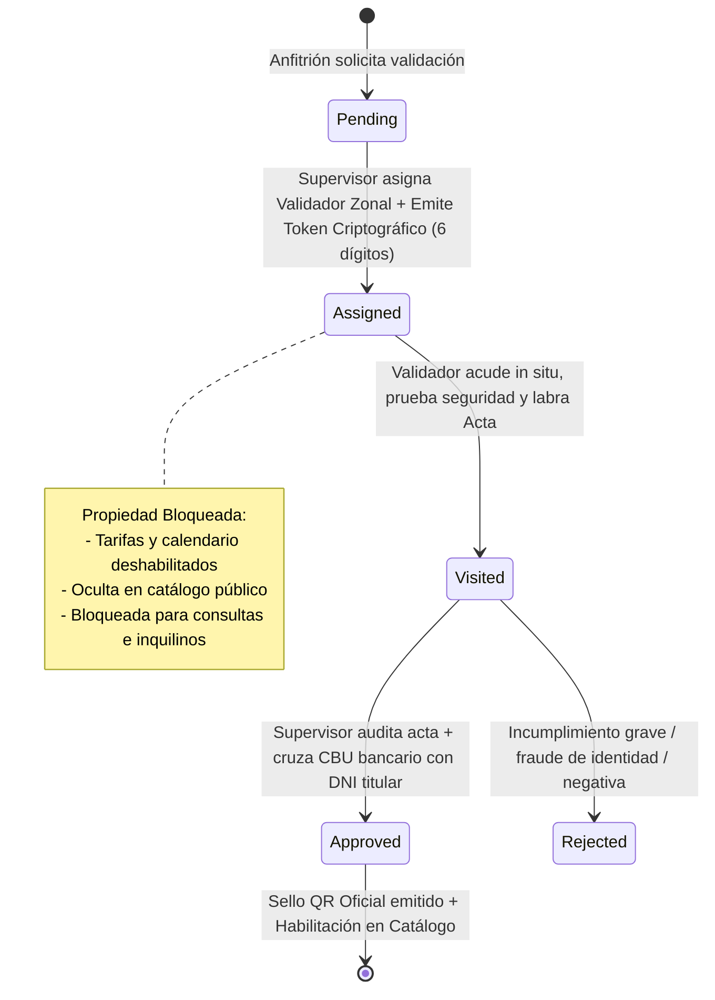
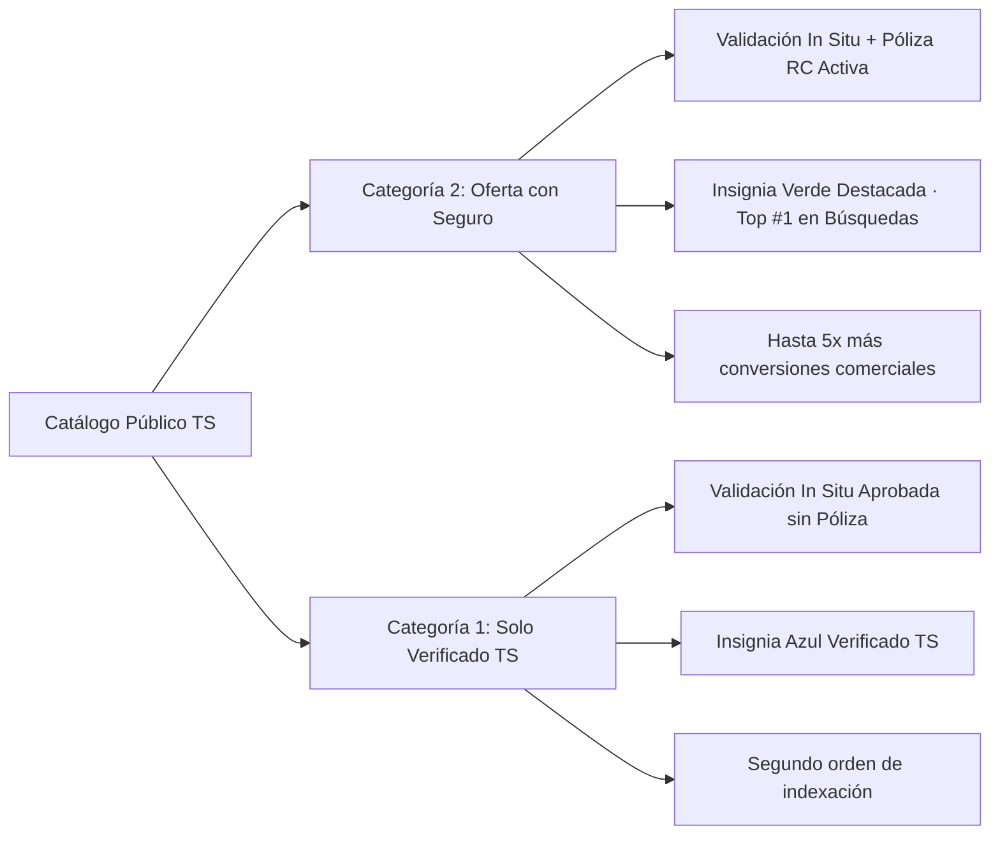

# PRD — Product Requirements Document
## Turismo Seguro

> **Tesis de Negocio e Iniciativa Privada:** Turismo Seguro es una plataforma digital y compañía privada de certificación pericial física *in situ*, blindaje antifraude y comercialización de alquileres temporarios, quintas diurnas y experiencias turísticas. Su modelo de negocio se basa en la erradicación total de estafas virtuales mediante la inspección presencial obligatoria y el otorgamiento del sello oficial **"San Juan Verificado TS"**, articulando el cobro de aranceles de homologación y suscripciones SaaS a propietarios, comisiones escalonadas para una red territorial de validadores comerciales matriculados, convenios marco con entes gubernamentales/municipales y alianzas estratégicas aseguradoras (Insurtech).

---

## 1. Resumen Ejecutivo y Visión Estratégica

* **Nombre Oficial del Producto:** Turismo Seguro (Marca matriz) / San Juan Verificado (Sello regional oficial).
* **Naturaleza Jurídica y Operativa:** Empresa privada independiente con convenios marco institucionales de colaboración y homologación con el Ministerio de Turismo, Cultura y Deporte de San Juan, cámaras empresarias inmobiliarias y municipios turísticos provinciales.
* **Dominios Web Oficiales:** `turismoseguro.com.ar`, `turismoseguro.ar` y `api.turismoseguro.com.ar`.
* **Problema Central de Mercado:**
  1. Epidemia de estafas virtuales mediante alquileres "fantasma" en redes sociales (Facebook Marketplace, Instagram, WhatsApp) con fotos falsas, suplantación de identidad y pedidos de señas o transferencias bancarias a cuentas fraudulentas.
  2. Falta de garantías de seguridad pasiva en quintas y alojamientos con piscinas (ausencia de cercos perimetrales, matafuegos vencidos, sin disyuntores diferenciales ni seguro de responsabilidad civil).
  3. Desprotección de anfitriones y propietarios frente a huéspedes conflictivos, daños en instalaciones o exceso sonoro/aforo.
* **Propósito Fundamental:** Erradicar al 100% las estafas en el alquiler temporal y recreativo en San Juan, convirtiéndose en el estándar de oro de autenticidad física, legal y aseguradora tanto para turistas de todo el país y el mundo, como para los propios residentes sanjuaninos (quintas, eventos y fines de semana).

---

## 2. Propuesta de Valor Diferencial (Por Segmento)

```mermaid
flowchart TD
    TS["Turismo Seguro (Plataforma & Certificación)"]
    
    TS --> PROP["Propietarios / Anfitriones"]
    TS --> INQ["Inquilinos / Turistas / Sanjuaninos"]
    TS --> VAL["Validadores Matriculados"]
    TS --> INST["Aseguradoras & Entes Turísticos"]

    PROP --> P1["Sello San Juan Verificado oficial"]
    PROP --> P2["Blindaje contra suplantación y usurpación"]
    PROP --> P3["Motor tarifario multi-modalidad & Ficha inquilinos"]
    PROP --> P4["Pólizas de Responsabilidad Civil simplificadas"]

    INQ --> I1["Tasa cero de estafas en señas y reservas"]
    INQ --> I2["Garantía física in situ (seguridad pasiva, pileta)"]
    INQ --> I3["Cuentas de cobro CBU verificadas por DNI"]
    INQ --> I4["Microseguros por jornada accesibles"]

    VAL --> V1["Comisión agresiva de captación (60%-70% Mes 1)"]
    VAL --> V2["Ingresos residuales por cartera activa (15%-20%)"]
    VAL --> V3["Herramientas móviles operativas de terreno"]

    INST --> S1["Homologación del parque turístico informal"]
    INST --> S2["Cero riesgo en suscripción de pólizas (inspección previa)"]
```

---

## 3. Modelo de Negocio, Estructura de Ingresos y Comisiones

El modelo comercial opera bajo un esquema híbrido de arancel pericial inicial, suscripción de software (SaaS) recurrente y monetización por intermediación de pólizas (Insurtech):

### 3.1 Fuentes de Ingresos
1. **Arancel Inicial de Homologación & Peritaje (Mes 1):**
   * Cobro al cliente oferente por la visita física presencial del inspector, georreferenciación GPS milimétrica, relevamiento fotográfico de control, confección del Acta Oficial de Homologación y emisión del Token/QR criptográfico inicial.
2. **Suscripción Recurrente de Mantenimiento y Visibilidad (Mes 2 en adelante):**
   * Cuota mensual SaaS para mantener el Sello Verificado activo en el catálogo público, indexación preferente en el motor de búsqueda, calendario interactivo de disponibilidad, motor de tarifas segmentadas y acceso a la ficha prontuarial de inquilinos.
3. **Comisiones por Pólizas y Microseguros (Triunfo Seguros / Alianzas Insurtech):**
   * Margen de intermediación en la contratación de Pólizas Mensuales/Anuales de Responsabilidad Civil para propietarios y en la emisión de Microseguros por Día para inquilinos.

### 3.2 Esquema de Comisiones para Validadores Comerciales en Terreno
Para romper la inercia del mercado y acelerar la captación territorial en todos los departamentos de San Juan (Zonda, Ullum, Pocito, Rawson, Calingasta, Iglesia, etc.), el sistema implementa comisiones escalonadas:

| Etapa Comercial | Comisión Validador | Margen Plataforma TS | Función Operativa y Justificación |
| :--- | :--- | :--- | :--- |
| **Mes 1: Captación e Inspección** | **60% al 70%** del arancel | 30% al 40% | Retribuye la movilidad en calle, convencer al anfitrión reticente y labrar el acta técnica in situ. |
| **Mes 2+: Cartera Activa (Residual)** | **15% al 20%** mensual | 80% al 85% | Incentiva al validador a fidelizar al anfitrión, asesorarlo en servicios y garantizar la renovación de la membresía. |
| **Margen Operativo TS** | — | **Margen neto** | Financia la infraestructura en la nube, servidores, campañas de marketing de demanda y soporte legal. |

---

## 4. Gobernanza de los 5 Roles del Ecosistema

El sistema implementa una separación estricta de responsabilidades entre 5 roles de usuario con políticas de autorización nativas:

| Rol | Slug en BD | Atribuciones y Responsabilidades Clave | Pantalla / Vistas Principales |
| :--- | :--- | :--- | :--- |
| **Super Admin** | `super_admin` | Gobierno general del negocio, contabilidad, fijación de aranceles y tarifas, auditoría global de comisiones, analítica territorial y de demanda, gestión de roles de usuarios. | Consola de Administración Central |
| **Supervisor de Calidad** | `supervisor` | **Torre de Control y Auditoría Antifraude Interna:** Asigna peticiones entrantes a validadores zonales, audita actas periciales y fotos de terreno, corrobora la cuenta bancaria (CBU/CVU) contra el DNI y emite el dictamen final aprobatorio o denegatorio. | Mesa de Supervisión y Dictámenes Técnicos, Conciliación Bancaria |
| **Validador Comercial** | `validator` | Fuerza en calle: Audita predios en terreno (cerco pileta, disyuntor, matafuego ABC, botiquín), coteja DNI/titularidad, toma fotos georreferenciadas, labra el acta digital y consulta su balance de comisiones devengadas. | Bandeja Operativa de Validación, Acta de Inspección In Situ, Mapa de Rutas |
| **Cliente Oferente / Anfitrión** | `client` | Propietario o administrador comercial verificado: Carga inmuebles, solicita auditoría, gestiona tarifas multi-modalidad (semana, finde, eventos), gestiona disponibilidad en calendario, califica a inquilinos y emite pólizas de seguro. | Panel del Propietario, Vista de Trámite de Homologación, Modales Tarifarios |
| **Inquilino / Interesado** | `rent` | Turista o residente sanjuanino: Declara su procedencia geográfica (nacional, extranjero o local), explora predios verificados con o sin seguro, cotiza microseguros por día, consulta disponibilidad y contacta al anfitrión vía WhatsApp oficial auditado. | Catálogo Público, Detalle de Inmueble, Hub de Experiencias, Panel del Inquilino |

---

## 5. Ciclo de Vida del Trámite de Homologación y Blindaje Antifraude

### Reglas Críticas Antifraude:
1. **Regla Canónica de Cero Publicación:** Ningún inmueble puede ser publicado en el catálogo público ni recibir consultas antes de que el supervisor apruebe el dictamen pericial formal.
2. **Bloqueo Operativo Preventivo:** Mientras el trámite se encuentre en estado `pending`, `assigned` o `visited`, la propiedad queda completamente congelada en el panel del dueño (sin posibilidad de alterar tarifas, alterar disponibilidad ni recibir contactos de interesados).
3. **Token Antifraude Diferido:** El sistema genera un token de seguridad numérico único al asignar el validador, exigido en la inspección física para confirmar la presencia en el inmueble y evitar colusiones a distancia.
4. **Gobernanza de Cuenta de Cobro Única (CBU / Billetera Virtual):**
   * La cuenta donde el anfitrión cobra señas y alquileres (CBU bancario o alias de Mercado Pago) **debe ser única en el sistema** y **pertenecer fehacientemente al mismo titular DNI auditado**.
   * Esto erradica totalmente las transferencias a "cuentas mula" o triangulaciones de intermediarios ilegítimos.

---

## 6. El Acta Oficial de Homologación e Instrumento Legal

* **Estructura Correlativa Canónica:** Formato `Acta #[N°]-[DEP]/[AÑO]` (ejemplo canónico en el sistema: `Acta #849-MED/26`, donde `849` es el correlativo, `MED` es Médano de Oro / Rawson y `26` es el año 2026).
* **Checklist Pericial Obligatorio de Seguridad Pasiva:**
  * Cerco perimetral de seguridad para pileta (mínimo 1,20 m de altura con cerradura/traba de seguridad infantil).
  * Disyuntor diferencial con pulsador de test operativo (sensibilidad $\le 30\text{ mA}$) y llave termomagnética reglamentaria.
  * Matafuegos triclase ABC con carga vigente y sello IRAM al día.
  * Botiquín reglamentario de primeros auxilios.
  * Luces de emergencia autónomas operativas en quincho y accesos.
  * Coincidencia geométrica GPS con el domicilio catastral y plano municipal.
* **Triple Valor del Acta Técnica:**
  1. **Algoritmo de Catálogo:** Requisito indispensable para obtener la insignia y clasificar en los primeros puestos.
  2. **Asegurabilidad Inmediata:** Documento técnico-legal vinculante requerido por la aseguradora (Triunfo Seguros) para la suscripción de pólizas de Responsabilidad Civil.
  3. **Blindaje Legal Administrativo:** Documento oponible ante inspecciones del Ministerio de Turismo, Municipalidades y AFIP/DGR.

---

## 7. Motor Tarifario Multi-Modalidad del Anfitrión

Dado que el mercado sanjuanino combina alojamientos temporales turísticos (noches) con quintas recreativas diurnas y predios de eventos, el motor tarifario de Turismo Seguro contempla:

### 7.1 Esquema de Precios Diferenciados
* **Lunes a Jueves (Días Hábiles):** Tarifa base accesible para teletrabajo, reuniones reducidas o descanso diurno.
* **Viernes a Domingo (Fin de Semana Regular):** Tarifa recreativa estándar para grupos familiares o sociales.
* **Sábados y Feriados (Picos de Alta Demanda):** Tarifas pico para fines de semana largos, Fiesta Nacional del Sol y vendimias.
* **Eventos Especiales:** Suplemento tarifario específico por aforo ampliado (cumpleaños, bautismos, bodas diurnas de 40 a 100+ personas).
* **Pernocte Adicional:** Arancel complementario por invitado que pernocta en camas interiores o predio tras el evento diurno.

### 7.2 Modalidades de Turno Diurno
* **Día Completo:** 10:00 a 20:00 o 21:00 hs.
* **Turno Mañana:** 09:00 a 14:00 hs.
* **Turno Tarde / Noche:** 15:00 a 23:00 hs.

### 7.3 Estados de Bloqueo en Calendario
* **Reserva Confirmada:** Días bloqueados con seña o alquiler completado.
* **Mantenimiento / Refacción:** Días vedados para tareas de jardinería, pintura o reparación de pileta.
* **Pausa por Vacaciones:** Período de indisponibilidad temporal configurado por el propietario.

---

## 8. Sistema de Reputación, Scoring y Ficha Prontuarial de Inquilinos

El sistema protege a los propietarios mediante una gobernanza bidireccional y un historial confiable de comportamiento de huéspedes:

### 8.1 Escala Canónica de Calificación (5 Estados en Base de Datos)
Al finalizar un alquiler, el propietario califica al inquilino mediante la siguiente escala registrada en la tabla `bookings`:

| Código en BD | Denominación Canónica | Indicador UI | Regla Operativa y Significado |
| :--- | :--- | :--- | :--- |
| `up` | **Buen Inquilino** | 🟢 Verde (`thumb_up`) | Huésped ejemplar: cuidó instalaciones, respetó horarios de egreso y límites de sonido. |
| `follow_up` | **En Observación** | 🟡 Ámbar (`visibility`) | Huésped admisible pero con llamados de atención menores (demora menor en checkout, vajilla desordenada). |
| `down` | **No Conforme** | 🔴 Rojo suave (`thumb_down`) | Falta o incumplimiento comprobado: ruidos fuera de hora, desorden grave o daño accidental no compensado. |
| `rejected` | **No Aceptar / Vetado** | ⛔ Rojo oscuro (`block`) | Falta grave, maltrato a instalaciones, desmanes, agresión o exceso injustificado de aforo. Veto directo. |
| `none` | **Sin Calificación** | ⚪ Gris (`horizontal_rule`) | Reserva nueva sin evaluación post-egreso aún. |

### 8.2 Ficha Prontuarial Cruzada y Veto Automático
* **Trazabilidad Única por DNI / Teléfono:** La reputación y notas privadas (`owner_observation`) quedan vinculadas al perfil permanente del inquilino a través de la Red TS.
* **Mecanismo de Veto Directo (`rejected`):** Si un anfitrión marca a un usuario con `rejected`:
  1. *Ocultamiento Inteligente:* Las propiedades de dicho anfitrión dejan de aparecer en las búsquedas de ese inquilino.
  2. *Bloqueo de Reserva:* En caso de intentar contactar por enlace directo, el sistema notifica que el predio no dispone de cupo para su perfil.

### 8.3 Algoritmo Anti-Bias (Control de Propietarios Hipercríticos)
Para evitar que un anfitrión abusivo o conflictivo perjudique injustamente a huéspedes correctos, el sistema evalúa el ratio crítico:
$$\text{Ratio Host} = \frac{\text{Calificaciones Negativas } (\text{down} + \text{rejected})}{\text{Total de Alquileres Realizados}}$$
* Si el promedio provincial de calificaciones negativas es del 5% y un anfitrión supera el **35%**, se dispara una **Alerta de Sesgo**: sus votos pierden ponderación sobre el scoring público del inquilino y la Mesa de Supervisión audita el caso.

---

## 9. Categorización del Catálogo, Algoritmo de Búsqueda y Pólizas

### 9.1 Algoritmo de Ordenamiento en Búsquedas (`ordering_score`)
El catálogo público posiciona las ofertas de acuerdo con la fórmula matemática:
$$\text{Ordering Score} = (P_{\text{seguro}} \times 100) + (P_{\text{visita\_insitu}} \times 50) + (\text{Score}_{\text{reputacion}} \times 20) + \text{Bonus}_{\text{reciente}}$$

### 9.2 Modalidades de Cobertura (Alianza Triunfo Seguros / Insurtech)
1. **Para Propietarios:**
   * *Convenio Anual Bonificado:* 365 días de cobertura integral de Responsabilidad Civil y Daños con tarifa preferencial e insignia permanente.
   * *Póliza Mensual de Temporada:* Cobertura continua para quintas que operan intensivamente de noviembre a marzo.
2. **Para Inquilinos:**
   * *Microseguro por Jornada Diurna:* Arancel accesible por día de alquiler para cubrir accidentes personales, caídas y responsabilidad civil básica del grupo familiar o de amigos.
   * *Seguro de Eventos / Fiestas:* Cobertura especial con ampliación de aforo para eventos sociales diurnos de 50 a 100+ personas.

---

## 10. Arquitectura Tecnológica y Gobernanza de Código

### 10.1 Stack Tecnológico
* **Backend:** Laravel 13 (PHP 8.3+), Eloquent ORM, Laravel Sanctum, Form Requests dedicados, Base de datos SQLite / MySQL.
* **Frontend:** Vue 3 (Composition API con `<script setup>`), TypeScript estricto, Vite, Tailwind CSS con paleta Stitch (`Deep Navy`, `Emerald Assurance`, `San Juan Amber`, `Plus Jakarta Sans`).
* **Documentación & Contratos:** Contract-First gobernado por especificación **OpenAPI 3.1** en `contracts/openapi.yaml`, visualizado interactivamente con Scalar (`pnpm run docs`).

### 10.2 Estrategia de Autenticación
1. **Autenticación Tradicional:** Email y contraseña con hash Argon2/Bcrypt, cookies `HttpOnly`, protección CSRF nativa y flujo de recuperación de contraseña con token al correo.
2. **Social Login (Google OAuth 2.0):** Autenticación en 1 clic mediante Laravel Socialite, vinculación automática por correo y segmentación automática de procedencia geográfica (turistas vs residentes locales).

---

## 11. Métricas Clave (KPIs) y Criterios de Éxito

| Dimensión | Indicador Clave (KPI) | Meta Estratégica (Año 1) |
| :--- | :--- | :--- |
| **Seguridad Antifraude** | Tasa de incidentes o denuncias en predios certificados | **0% (Cero estafas en la Red TS)** |
| **Oferta Homologada** | Propietarios y quintas con sello activo vigente | **150+ predios certificados** |
| **Tiempo de Auditoría** | Lapso desde la solicitud hasta la visita física pericial | **< 48 a 72 horas hábiles** |
| **Retención de Clientes** | Renovación mensual de suscripción SaaS de anfitriones | **> 85% de retención anual** |
| **Penetración de Seguros**| Inmuebles verificados con póliza activa (Categoría 2) | **> 60% del catálogo total** |
| **Fuerza Comercial** | Validadores matriculados activos con cartera en calle | **12 a 20 validadores departamentales** |

---

## 12. Insumos Directos para Análisis Estratégico (FODA y Business Model Canvas)

Este PRD aporta los siguientes pilares de valor explícitos para estructurar la matriz FODA y el Business Model Canvas:
* **Segmentos de Clientes:** Propietarios de quintas/cabañas en San Juan, Turistas nacionales/internacionales, Residentes locales sanjuaninos (demanda de fin de semana y eventos), Validadores comerciales matriculados.
* **Propuestas de Valor:** Confianza y tasa cero de estafas, blindaje antifraude mediante peritaje in situ, seguros de caución y RC accesibles, reputación cruzada de inquilinos, motor de disponibilidad y tarifas multi-modalidad.
* **Canales:** Portal web responsive móvil, WhatsApp oficial auditado, red comercial de validadores en calle, alianzas institucionales con municipios y entes turísticos.
* **Fuentes de Ingresos:** Aranceles de homologación y peritaje (Mes 1), suscripción SaaS mensual de anfitriones (Mes 2+), comisiones de intermediación en microseguros y pólizas de caución.
* **Estructura de Costes:** Comisiones a validadores en calle (60-70% mes 1, 15-20% residual), servidores en la nube y mantenimiento de plataforma, marketing digital y pauta geolocalizada, honorarios de inspección pericial y soporte legal.
* **Socios Clave:** Ministerio de Turismo de San Juan, Aseguradoras (Triunfo Seguros), Cámaras Inmobiliarias Departamentales, Validadores periciales matriculados.
