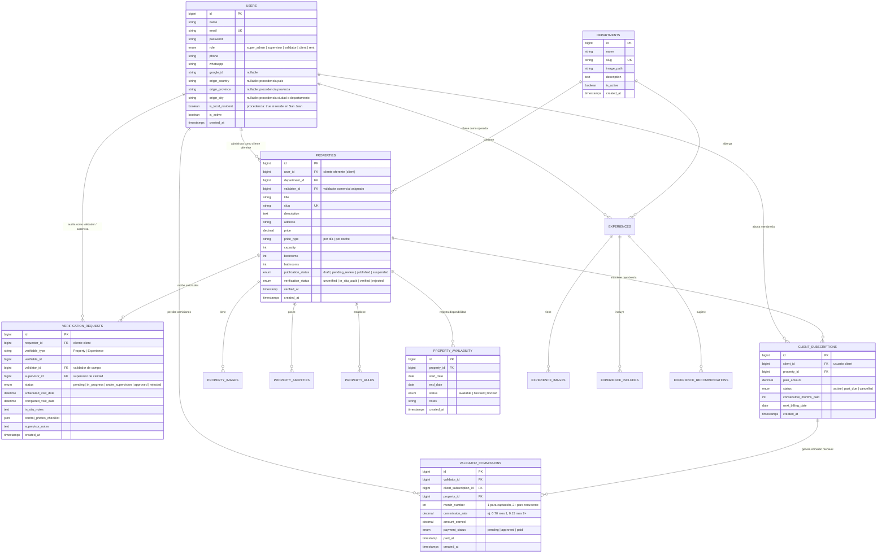

# Arquitectura del Sistema: Turismo Seguro San Juan

## 1. Visión y Principios de Diseño

**Turismo Seguro San Juan** es una plataforma digital desacoplada de origen **privado**, concebida para brindar certeza y confianza en el mercado turístico y de alquileres temporales mediante la auditoría física *in situ* y el otorgamiento del sello oficial **"Verificado TS"**.

### Principios Fundamentales:
1. **Arquitectura Desacoplada (`server/` y `client/`):**
   - **Backend API (`server/`):** Desarrollado en **Laravel** configurado como API REST pura. Gestiona modelos relacionales, reglas de verificación, cálculo de comisiones, liquidaciones y seguridad de acceso.
   - **Frontend Reactivo (`client/`):** Desarrollado en **Vue 3** con Composition API (`<script setup>`), TypeScript, **Tailwind CSS**, **Pinia** y **Vite**.
   - **Composables First en el Frontend:** La lógica de negocio, llamadas a la API y estado reactivo se encapsulan en **Composables reutilizables** (`useAuth`, `useProperties`, `useAvailability`, `useInspection`, `useCommissions`, `usePermissions`).
2. **Jerarquía de Roles de Seguridad (5 Roles):**
   - `super_admin`: Administración general, balances financieros, analíticas de procedencia y liquidación de comisiones a validadores.
   - `supervisor`: Control de calidad y filtro antifraude. Audita las actas y fotos subidas por los validadores; aprueba o rechaza el Sello TS y da de alta o baja las publicaciones.
   - `validator`: Captador y auditor en terreno. Inspecciona propiedades, sube fotos in situ y monitorea sus comisiones devengadas.
   - `client`: Cliente oferente / anfitrión. Solicita verificación, edita fichas y administra su **calendario de disponibilidad** (bloqueo de fechas ocupadas).
   - `rent`: Usuario interesado en alquilar o contratar (turista nacional/internacional o habitante local sanjuanino). Se registra su **procedencia geográfica** para enriquecer las estadísticas del sistema.
3. **Dominios Privados y Autenticación:**
   - Dominio comercial (`turismoseguro.com.ar` y `api.turismoseguro.com.ar`).
   - Autenticación segura SPA con cookies `HttpOnly` y protección CSRF con **Laravel Sanctum**.
   - Preparado para integración con **Google Sign-In (OAuth 2.0)** vía Laravel Socialite.
4. **Persistencia y Base de Datos:**
   - **SQLite** como motor predeterminado para el MVP y desarrollo local en un solo archivo físico.
   - Abstracción mediante **Eloquent ORM** para migrar de forma transparente a PostgreSQL o MySQL cuando la escala comercial lo demande.

---

## 2. Diagrama de Arquitectura del Sistema

```mermaid
graph TD
    subgraph Cliente_Vue ["Frontend Client (client/ - Vue 3 + Composables)"]
        Router[Vue Router: Guards por Rol]
        Composables[Composables: useAuth, useProperties, useAvailability, useInspection, useCommissions]
        Views[Vistas: Public, Client Panel, Validator App, Supervisor Board, Admin Dashboard]
        PiniaStore[Pinia Stores: auth, properties, availability]
    end

    subgraph Servidor_Laravel ["Backend Server (server/ - Laravel API)"]
        subgraph Capa_API ["Rutas y Middleware (routes/api.php)"]
            APIRouter[Laravel API Router: v1]
            SanctumMid[Middleware: Sanctum SPA Auth & CSRF]
            RoleMid[Middleware: CheckRole: super_admin, supervisor, validator, client, rent]
            ThrottleMid[Middleware: Rate Limiting / Throttle]
        end

        subgraph Capa_Controladores ["Controladores API"]
            PublicCtrl[Public: Properties, Experiences, Departments]
            ClientCtrl[Client: Listings & Availability Calendar]
            ValCtrl[Validator: Field Audits & In-Situ Photos]
            SupervCtrl[Supervisor: Quality Review & Sello Approvals]
            AdminCtrl[SuperAdmin: Metrics, Users, Provenance & Commissions Payouts]
        end

        subgraph Capa_Dominio ["Servicios y Lógica de Negocio"]
            Services[Services: CommissionService, VerificationService, AvailabilityService]
            FormRequests[Form Requests: Validación estricta con procedencia para rent]
            Resources[API Resources: DTOs JSON estándar]
        end

        subgraph Capa_Datos ["Persistencia y Archivos"]
            SQLite[(Base de Datos: database.sqlite)]
            Storage[(Almacenamiento Local / Cloud: /storage/propiedades)]
        end
    end

    Cliente_Vue <-->|HTTPS REST JSON (CORS restringido + Cookies Sanctum)| Capa_API
    APIRouter --> ThrottleMid --> SanctumMid --> RoleMid --> Capa_Controladores
    Capa_Controladores --> FormRequests
    Capa_Controladores --> Services
    Services --> Resources
    Services --> Capa_Datos
```

---

## 3. Modelo de Datos y Esquema Relacional (ER Diagram)



---

## 4. Estructura de Directorios del Proyecto

Con la consolidación en **`.agents/`**, la estructura queda unificada:

```text
ts_turismoseguro/
├── .agents/                            # Skills del asistente y workflows
│   ├── skills/
│   │   ├── api-design/
│   │   ├── database-migrations/
│   │   ├── laravel-best-practices/
│   │   ├── laravel-security/
│   │   ├── laravel-tdd/
│   │   ├── seo/
│   │   ├── ui-ux-pro-max/
│   │   └── vue-best-practices/
│   └── workflows/
│       └── promt.md
├── design-system/                      # Master Design System (UI/UX Pro Max)
│   └── turismo-seguro-san-juan/
│       └── MASTER.md
├── doc/                                # Documentación completa del proyecto
│   ├── PRD.md
│   ├── context.md
│   ├── arquitectura.md
│   ├── visual.md
│   ├── implementacion.md
│   └── README.md
├── legacy/                             # Prototipo original (resguardado en rama legacy)
├── server/                             # Backend API en Laravel
│   ├── app/
│   │   ├── Http/
│   │   │   ├── Controllers/Api/
│   │   │   │   ├── Admin/              (Super Admin: Métricas, Procedencia y Liquidaciones)
│   │   │   │   ├── Supervisor/         (Control de Calidad: Aprobación de Actas y Sellos)
│   │   │   │   ├── Validator/          (Actas In Situ, Fotos y Consulta de Comisiones)
│   │   │   │   ├── Client/             (Cliente Oferente: Mis Alojamientos y Calendario)
│   │   │   │   ├── Public/             (Catálogo, Fichas, Búsqueda y Disponibilidad Pública)
│   │   │   │   └── Auth/               (Login, Registro con Procedencia, Google OAuth)
│   │   │   ├── Middleware/
│   │   │   │   └── CheckRole.php
│   │   │   ├── Requests/
│   │   │   │   ├── RegisterRentRequest.php   (Valida datos de procedencia)
│   │   │   │   └── RegisterClientRequest.php
│   │   │   └── Resources/
│   │   ├── Models/
│   │   └── Services/
│   │       ├── CommissionService.php   (Lógica de cálculo: Mes 1 = 70%, Meses 2+ = 15%)
│   │       ├── AvailabilityService.php (Validación de rangos y fechas bloqueadas)
│   │       └── VerificationService.php (Flujo de aprobación Validador -> Supervisor)
│   ├── routes/
│   │   └── api.php
│   └── database/
└── client/                             # Frontend SPA en Vue 3 + Tailwind + Vite
    ├── src/
    │   ├── composables/                # LÓGICA DE NEGOCIO Y API (Composables First)
    │   │   ├── useAuth.ts              # Login, Logout, Registro con Procedencia, Google OAuth
    │   │   ├── usePermissions.ts       # Guards reactivos: isSuperAdmin, isSupervisor, isValidator, isClient, isRent
    │   │   ├── useProperties.ts        # Catálogo, filtros por departamento, paginación
    │   │   ├── useAvailability.ts      # Calendario de cliente y consulta pública de fechas
    │   │   ├── useInspection.ts        # Checklist in situ móvil, geolocalización, fotos
    │   │   └── useCommissions.ts       # Dashboard de ganancias del validador y liquidaciones
    │   ├── components/
    │   │   ├── common/                 # BadgeVerified, Navbar, Footer, ContactButtons
    │   │   ├── properties/             # PropertyCard, PropertyGallery, FilterSidebar, AvailabilityPicker
    │   │   ├── client/                 # AvailabilityCalendar, PropertyForm (panel de cliente oferente)
    │   │   ├── validator/              # InspectionChecklist, PhotoUploader, CommissionCard
    │   │   └── supervisor/             # AuditReviewCard, PhotoCompareModal
    │   ├── views/
    │   │   ├── public/                 # HomeView, PropertiesView, PropertyDetailView, ExperiencesView
    │   │   ├── auth/                   # LoginView, RegisterRentView, RegisterClientView, ForgotPasswordView, ResetPasswordView, GoogleCallbackView
    │   │   ├── client/                 # ClientDashboardView, ClientCalendarView, MyPropertiesView
    │   │   ├── validator/              # ValidatorMobileAppView, MyCommissionsView
    │   │   ├── supervisor/             # QualityControlView, AuditReviewDetailView
    │   │   └── admin/                  # SuperAdminDashboardView, ProvenanceStatsView, CommissionsPayoutView
    │   ├── stores/                     # Pinia stores
    │   ├── router/                     # Rutas con navegación tipada y guards por rol
    │   ├── types/
    │   └── App.vue
    └── package.json
```

---

## 5. Arquitectura de Composables en Vue 3 (`client/src/composables/`)

| Composable | Responsabilidad y Métodos Clave |
| :--- | :--- |
| `useAuth()` | `login()`, `registerRent(userData, provenanceData)`, `registerClient()`, `loginWithGoogle()`, `user`, `isAuthenticated`. |
| `usePermissions()` | `hasRole(role)`, `isSuperAdmin`, `isSupervisor`, `isValidator`, `isClient`, `isRent`. Utilizado en Vue Router y botones condicionales. |
| `useProperties()` | `properties`, `loading`, `fetchProperties(filters)`, `getPropertyBySlug(slug)`, `applyFilter()`. |
| `useAvailability(propertyId)` | `calendarDates`, `fetchAvailability(month, year)`, `blockDates(range)`, `unblockDates(range)`, `isDateAvailable(date)`. |
| `useInspection()` | `currentAudit`, `checklistItems`, `uploadPhoto(file)`, `submitAudit()`, `captureGeoLocation()`. |
| `useCommissions()` | `commissionsSummary`, `fetchMyEarnings()`, `month1Commissions`, `recurringCommissions`, `payoutHistory`. |

---

## 6. Mapeo de Endpoints de la API (`server/routes/api.php`)

```php
// Prefijo global /api/v1

// --- PÚBLICO (Navegación y Consulta) ---
Route::prefix('v1')->group(function () {
    Route::get('/properties', [PropertyCatalogController::class, 'index']);
    Route::get('/properties/{slug}', [PropertyCatalogController::class, 'show']);
    Route::get('/properties/{id}/availability', [PropertyCatalogController::class, 'checkAvailability']);
    Route::get('/experiences', [ExperienceCatalogController::class, 'index']);
    Route::get('/departments', [DepartmentController::class, 'index']);

    // --- AUTENTICACIÓN COMÚN (Sanctum SPA) Y GOOGLE OAUTH ---
    Route::post('/auth/login', [AuthController::class, 'login']);
    Route::post('/auth/register/rent', [AuthController::class, 'registerRent']);     // Incluye procedencia geográfica
    Route::post('/auth/register/client', [AuthController::class, 'registerClient']);
    Route::post('/auth/forgot-password', [PasswordResetController::class, 'sendResetLinkEmail']);
    Route::post('/auth/reset-password', [PasswordResetController::class, 'resetPassword']);
    Route::get('/auth/google/redirect', [GoogleAuthController::class, 'redirect']);
    Route::get('/auth/google/callback', [GoogleAuthController::class, 'callback']);

    Route::middleware('auth:sanctum')->group(function () {
        Route::post('/auth/logout', [AuthController::class, 'logout']);
        Route::get('/auth/me', [AuthController::class, 'me']);

        // --- PANEL CLIENTE OFERENTE (client) ---
        Route::middleware('role:client')->prefix('client')->group(function () {
            Route::get('/properties', [ClientPropertyController::class, 'index']);
            Route::post('/properties', [ClientPropertyController::class, 'store']);
            Route::put('/properties/{id}', [ClientPropertyController::class, 'update']);
            Route::get('/properties/{id}/availability', [ClientAvailabilityController::class, 'index']);
            Route::post('/properties/{id}/availability/block', [ClientAvailabilityController::class, 'blockDates']);
            Route::post('/verifications/request', [ClientPropertyController::class, 'requestAudit']);
        });

        // --- PANEL VALIDADOR EN TERRENO (validator) ---
        Route::middleware('role:validator')->prefix('validator')->group(function () {
            Route::get('/tasks', [ValidatorAuditController::class, 'assignedTasks']);
            Route::post('/audits/{id}/submit', [ValidatorAuditController::class, 'submitAudit']);
            Route::post('/audits/{id}/photos', [ValidatorAuditController::class, 'uploadInSituPhoto']);
            Route::get('/commissions', [ValidatorCommissionController::class, 'myCommissions']);
        });

        // --- PANEL SUPERVISOR / CONTROL DE CALIDAD (supervisor) ---
        Route::middleware('role:supervisor')->prefix('supervisor')->group(function () {
            Route::get('/audits/pending', [SupervisorReviewController::class, 'pendingAudits']);
            Route::post('/audits/{id}/approve', [SupervisorReviewController::class, 'approveSeal']);
            Route::post('/audits/{id}/reject', [SupervisorReviewController::class, 'rejectAudit']);
            Route::patch('/properties/{id}/toggle-status', [SupervisorReviewController::class, 'togglePublication']);
        });

        // --- PANEL SUPER ADMIN (super_admin) ---
        Route::middleware('role:super_admin')->prefix('admin')->group(function () {
            Route::get('/metrics', [AdminDashboardController::class, 'metrics']);
            Route::get('/metrics/provenance', [AdminDashboardController::class, 'provenanceAnalytics']);
            Route::get('/users', [AdminUserController::class, 'index']);
            Route::get('/commissions/payouts', [AdminCommissionController::class, 'payoutsSummary']);
            Route::post('/commissions/payouts/{id}/mark-paid', [AdminCommissionController::class, 'markPaid']);
        });
    });
});
```

---

## 7. Políticas de Seguridad y Reglas de Negocio

1. **Regla de No Publicación:**
   - Una propiedad con `verification_status != 'verified'` o `publication_status != 'published'` es filtrada automáticamente por un *Global Scope* en Eloquent, impidiendo su exposición en endpoints públicos.
2. **Protección de Calendario de Disponibilidad:**
   - Solo el usuario `client` dueño de la propiedad o un `super_admin` pueden modificar las fechas bloqueadas.
3. **Tratamiento del Dato de Procedencia (`rent`):**
   - El origen declarado (país, provincia, localidad) se almacena para fines analíticos agregados y no se expone públicamente a terceros.
4. **Cálculo Determinista de Comisiones:**
   - La clase `CommissionService` encapsula las tasas según el número de mes:
     $$\text{Mes 1: } \text{Comisión} = \text{Monto} \times 0.70$$
     $$\text{Mes 2+: } \text{Comisión} = \text{Monto} \times 0.15$$
