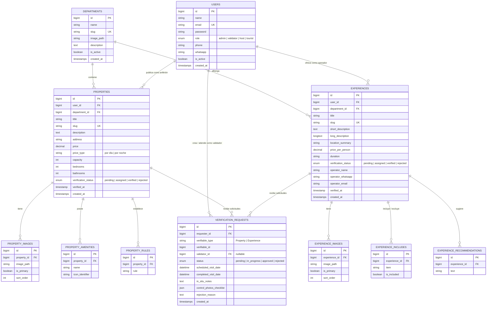

# Arquitectura del Sistema: Turismo Seguro San Juan

## 1. Visión y Principios de Diseño

**Turismo Seguro San Juan** es una plataforma digital de certificación y catálogo de confianza de origen **privado**, concebida para erradicar las estafas en alquileres temporales y experiencias turísticas mediante la auditoría física *in situ* y el otorgamiento del sello de calidad **"Verificado TS"**.

### Principios Fundamentales:
1. **Arquitectura Desacoplada (`server/` y `client/`):**
   - **Backend API (`server/`):** Desarrollado en **Laravel** configurado como API REST pura. Gestiona la lógica de negocio, persistencia, validaciones de auditoría y seguridad.
   - **Frontend Reactivo (`client/`):** Desarrollado en **Vue 3** con Composition API (`<script setup>`), TypeScript, **Tailwind CSS**, **Pinia** para estado global y **Vite** como empaquetador ultrarrápido.
   - **Preparado para Web y Mobile:** La separación física permite servir la Web pública y el panel operativo, mientras que la misma API servirá a futuras aplicaciones móviles nativas (vía Capacitor/Ionic o Flutter) sin tener que reescribir el backend.
2. **Dominios Privados y Seguridad:**
   - La plataforma opera bajo dominios comerciales privados (ej. `turismoseguro.com.ar` para el frontend y `api.turismoseguro.com.ar` para la API).
   - Autenticación SPA segura mediante **Laravel Sanctum** con cookies `HttpOnly` y `SameSite=Lax` para la web (protección contra XSS) y tokens Bearer para dispositivos móviles.
   - Articulación con entes oficiales (Secretaría de Turismo de San Juan, municipios y cámaras) bajo **convenios de colaboración institucional**, manteniendo la independencia operativa y tecnológica.
3. **Persistencia y Base de Datos:**
   - **SQLite** como motor predeterminado para el MVP y desarrollo local (portabilidad completa sin necesidad de configurar servicios de base de datos dedicados).
   - Abstracción mediante **Eloquent ORM** y migraciones declarativas estándar, garantizando una transición inmediata a PostgreSQL o MySQL cuando la escala privada del servicio lo requiera.
4. **Componentización y DRY (Don't Repeat Yourself):**
   - Reemplazo total de la duplicación del prototipo legacy mediante componentes reutilizables de Vue 3 (`PropertyCard`, `ExperienceCard`, `BadgeVerified`, `ContactButtons`, etc.).

---

## 2. Diagrama de Arquitectura del Sistema

```mermaid
graph TD
    subgraph Cliente_Vue ["Frontend Client (client/ - Vue 3 + Vite)"]
        SPA[Vue 3 SPA: Vue Router + Pinia]
        UI_Components[Componentes UI: Tailwind CSS + Iconos]
        Mobile_PWA[Web Responsive / PWA / Capacitor Ready]
    end

    subgraph Servidor_Laravel ["Backend Server (server/ - Laravel API)"]
        subgraph Capa_API ["Enrutamiento y Middleware (routes/api.php)"]
            Router[Laravel API Router]
            SanctumMid[Middleware: Sanctum SPA Auth & CSRF]
            RoleMid[Middleware: Role & Permission (admin, validator, host)]
            ThrottleMid[Middleware: Rate Limiting / Throttle]
        end

        subgraph Capa_Controladores ["Controladores API"]
            PublicCtrl[Public: Properties, Experiences, Departments]
            HostCtrl[Host: Verification Requests & Listings]
            ValCtrl[Validator: In-Situ Inspection & Audits]
            AdminCtrl[Admin: Management, Metrics & Users]
        end

        subgraph Capa_Dominio ["Servicios y Modelos Eloquent"]
            Models[Models: Property, Experience, VerificationRequest, User]
            Services[Services: VerificationService, MediaStorageService]
            FormRequests[Form Requests: Validación estricta de entrada]
            Resources[API Resources: Transformación JSON estándar]
        end

        subgraph Capa_Datos ["Persistencia y Archivos"]
            SQLite[(Base de Datos: database.sqlite)]
            Storage[(Almacenamiento Local / Cloud: /storage/propiedades)]
        end
    end

    Cliente_Vue <-->|HTTPS REST JSON (CORS restringido + Cookies Sanctum)| Capa_API
    Router --> ThrottleMid --> SanctumMid --> RoleMid --> Capa_Controladores
    Capa_Controladores --> FormRequests
    Capa_Controladores --> Capa_Dominio
    Capa_Dominio --> Resources
    Capa_Dominio --> Capa_Datos
```

---

## 3. Modelo de Datos y Esquema Relacional



---

## 4. Estructura de Directorios del Proyecto

La solución se estructura en dos carpetas principales independientes (`server/` y `client/`), más la carpeta de documentación (`doc/`) y el código histórico (`legacy/`):

```text
ts_turismoseguro/
├── doc/                                # Documentación del proyecto
│   ├── PRD.md
│   ├── context.md
│   ├── arquitectura.md
│   ├── visual.md
│   ├── implementacion.md
│   └── README.md
├── legacy/                             # Prototipo original estático (resguardado en rama legacy)
├── server/                             # Backend API en Laravel
│   ├── app/
│   │   ├── Http/
│   │   │   ├── Controllers/Api/
│   │   │   │   ├── Admin/
│   │   │   │   │   ├── DashboardController.php
│   │   │   │   │   ├── VerificationManagementController.php
│   │   │   │   │   └── ReportController.php
│   │   │   │   ├── Auth/
│   │   │   │   │   ├── AuthController.php
│   │   │   │   │   └── RegisterController.php
│   │   │   │   ├── Host/
│   │   │   │   │   ├── HostListingController.php
│   │   │   │   │   └── HostVerificationController.php
│   │   │   │   ├── Public/
│   │   │   │   │   ├── PropertyCatalogController.php
│   │   │   │   │   ├── ExperienceCatalogController.php
│   │   │   │   │   ├── DepartmentController.php
│   │   │   │   │   └── ContactController.php
│   │   │   │   └── Validator/
│   │   │   │       ├── ValidatorTaskController.php
│   │   │   │       └── InspectionAuditController.php
│   │   │   ├── Middleware/
│   │   │   │   └── CheckRole.php
│   │   │   ├── Requests/
│   │   │   │   ├── StoreVerificationRequest.php
│   │   │   │   ├── FilterPropertiesRequest.php
│   │   │   │   └── SubmitInspectionRequest.php
│   │   │   └── Resources/
│   │   │       ├── PropertyResource.php
│   │   │       ├── ExperienceResource.php
│   │   │       ├── DepartmentResource.php
│   │   │       └── VerificationRequestResource.php
│   │   ├── Models/
│   │   └── Services/
│   │       ├── VerificationService.php
│   │       └── MediaUploadService.php
│   ├── config/
│   │   ├── cors.php                    # Orígenes permitidos (turismoseguro.com.ar, localhost)
│   │   └── sanctum.php                 # Dominios de estado de sesión SPA
│   ├── database/
│   │   ├── database.sqlite
│   │   ├── migrations/
│   │   └── seeders/
│   │       ├── DatabaseSeeder.php
│   │       ├── DepartmentSeeder.php     (19 departamentos de San Juan)
│   │       ├── LegacyPropertySeeder.php (Importación desde datos de legacy/)
│   │       └── UserSeeder.php           (Cuentas iniciales: admin, validador, anfitriones)
│   ├── routes/
│   │   └── api.php                     # Endpoints REST de la API
│   ├── composer.json
│   └── .env
└── client/                             # Frontend SPA en Vue 3 + Tailwind + Vite
    ├── src/
    │   ├── assets/                     # Estilos globales y logotipos
    │   ├── components/                 # Componentes Vue reutilizables
    │   │   ├── common/
    │   │   │   ├── BadgeVerified.vue
    │   │   │   ├── ContactButtons.vue
    │   │   │   ├── Navbar.vue
    │   │   │   └── Footer.vue
    │   │   ├── properties/
    │   │   │   ├── PropertyCard.vue
    │   │   │   ├── PropertyGallery.vue
    │   │   │   └── FilterSidebar.vue
    │   │   ├── experiences/
    │   │   │   └── ExperienceCard.vue
    │   │   ├── departments/
    │   │   │   └── DepartmentCard.vue
    │   │   └── validator/
    │   │       ├── InspectionChecklist.vue
    │   │       └── PhotoUploader.vue
    │   ├── views/                      # Páginas del sistema
    │   │   ├── public/
    │   │   │   ├── HomeView.vue
    │   │   │   ├── PropertiesView.vue
    │   │   │   ├── PropertyDetailView.vue
    │   │   │   ├── ExperiencesView.vue
    │   │   │   ├── ExperienceDetailView.vue
    │   │   │   └── RequestVerificationView.vue
    │   │   ├── auth/
    │   │   │   └── LoginView.vue
    │   │   ├── validator/
    │   │   │   ├── ValidatorDashboardView.vue
    │   │   │   └── InspectionAuditView.vue
    │   │   └── admin/
    │   │       ├── AdminDashboardView.vue
    │   │       └── RequestsManagementView.vue
    │   ├── stores/                     # Gestión de estado Pinia
    │   │   ├── auth.ts
    │   │   ├── properties.ts
    │   │   └── verification.ts
    │   ├── services/                   # Cliente HTTP Axios / Fetch tipado
    │   │   └── api.ts
    │   ├── types/                      # Interfaces TypeScript
    │   │   ├── property.ts
    │   │   ├── experience.ts
    │   │   └── user.ts
    │   ├── router/
    │   │   └── index.ts                # Enrutador Vue Router con guards de rol
    │   ├── App.vue
    │   └── main.ts
    ├── index.html
    ├── vite.config.ts
    ├── tailwind.config.js
    └── package.json
```

---

## 5. Estrategia de Componentes Vue 3 (`client/`)

En el prototipo `legacy/` existía alta duplicación de código HTML y JavaScript. Con Vue 3 se abstrae mediante componentes reutilizables con **Composition API** y `<script setup>`:

| Componente Vue | Archivo Legacy Reemplazado | Responsabilidad |
| :--- | :--- | :--- |
| `<BadgeVerified :size="'sm' \| 'md' \| 'lg'" :verifiedAt="date" />` | Clases manuales dispersas | Muestra el escudo oficial TS con tooltip informativo de la auditoría física realizada. |
| `<PropertyCard :property="property" />` | Bloques repetidos en `index.html` y `alquileres.html` | Tarjeta con imagen, precio, capacidad, amenities y botón de detalle. |
| `<ExperienceCard :experience="experience" />` | Bloques repetidos en `experiencias-listado.html` | Tarjeta con duración, precio por persona, operador verificado y botón de contacto. |
| `<DepartmentCard :department="department" />` | 19 bloques duplicados en `index.html` | Visualiza foto del departamento sanjuanino, contador de inmuebles verificados y filtro directo. |
| `<FilterSidebar :departments="departments" @filter="onFilter" />` | Sidebar duplicado en `alquileres.html` | Panel interactivo de filtrado reactivo sin recarga de página. |
| `<ContactButtons :whatsapp="wa" :phone="tel" :title="title" />` | Código JS en `detalle-alquiler.js` | Botón a WhatsApp con texto de seguridad preconfigurado y llamada directa. |
| `<InspectionChecklist v-model="checklist" />` | Sin equivalente (nuevo) | Formulario móvil para que el validador marque ítems verificados en terreno. |
| `<PhotoUploader @upload="onPhotoUpload" />` | Sin equivalente (nuevo) | Carga y previsualización de fotografías de inspección física antes del envío. |

---

## 6. Mapeo de Endpoints de la API (`server/routes/api.php`)

```php
use App\Http\Controllers\Api\Public\PropertyCatalogController;
use App\Http\Controllers\Api\Public\ExperienceCatalogController;
use App\Http\Controllers\Api\Public\DepartmentController;
use App\Http\Controllers\Api\Public\ContactController;
use App\Http\Controllers\Api\Auth\AuthController;
use App\Http\Controllers\Api\Host\HostVerificationController;
use App\Http\Controllers\Api\Validator\ValidatorTaskController;
use App\Http\Controllers\Api\Validator\InspectionAuditController;
use App\Http\Controllers\Api\Admin\DashboardController;
use App\Http\Controllers\Api\Admin\VerificationManagementController;

// --- Rutas Públicas (Catálogo y Consulta) ---
Route::prefix('v1')->group(function () {
    Route::get('/properties', [PropertyCatalogController::class, 'index']);
    Route::get('/properties/{slug}', [PropertyCatalogController::class, 'show']);
    Route::get('/experiences', [ExperienceCatalogController::class, 'index']);
    Route::get('/experiences/{slug}', [ExperienceCatalogController::class, 'show']);
    Route::get('/departments', [DepartmentController::class, 'index']);
    Route::get('/departments/{slug}', [DepartmentController::class, 'show']);
    Route::post('/contact', [ContactController::class, 'send']);

    // --- Autenticación (Sanctum SPA Session) ---
    Route::post('/login', [AuthController::class, 'login']);
    Route::post('/logout', [AuthController::class, 'logout'])->middleware('auth:sanctum');
    Route::get('/me', [AuthController::class, 'me'])->middleware('auth:sanctum');

    // --- Solicitud de Certificación para Anfitriones ---
    Route::post('/verifications/request', [HostVerificationController::class, 'store']);

    // --- Portal del Validador Técnico (Rol: validator) ---
    Route::middleware(['auth:sanctum', 'role:validator'])->prefix('validator')->group(function () {
        Route::get('/tasks', [ValidatorTaskController::class, 'index']);
        Route::get('/inspections/{id}', [InspectionAuditController::class, 'show']);
        Route::post('/inspections/{id}/submit', [InspectionAuditController::class, 'submitAudit']);
        Route::post('/inspections/{id}/upload-photo', [InspectionAuditController::class, 'uploadControlPhoto']);
    });

    // --- Panel de Administración Privada (Rol: admin) ---
    Route::middleware(['auth:sanctum', 'role:admin'])->prefix('admin')->group(function () {
        Route::get('/metrics', [DashboardController::class, 'metrics']);
        Route::apiResource('/verifications', VerificationManagementController::class);
        Route::post('/verifications/{id}/assign', [VerificationManagementController::class, 'assignValidator']);
        Route::get('/reports/audit-export', [DashboardController::class, 'exportAuditReport']);
    });
});
```

---

## 7. Políticas de Seguridad y Buenas Prácticas

Siguiendo las directrices de `laravel-security` y `laravel-best-practices`:

1. **Autenticación SPA con Cookies `HttpOnly`:**
   - La comunicación entre `client/` y `server/` emplea cookies de sesión gestionadas por Laravel Sanctum.
   - No se almacenan tokens sensibles en `localStorage`, evitando exposición frente a vectores XSS.
2. **CORS Restringido a Dominios de la Empresa:**
   - En `config/cors.php`, únicamente se autorizan los orígenes del frontend (`turismoseguro.com.ar` y puertos de desarrollo local).
3. **Control de Frecuencia (Rate Limiting):**
   - Endpoints públicos como `/properties` y `/contact` cuentan con límites de peticiones (`throttle:60,1`) para prevenir extracción automatizada (scraping) de teléfonos o ataques de denegación de servicio.
4. **Validación Estricta con Form Requests:**
   - Ningún controlador valida en línea; cada endpoint cuenta con su clase de validación (`StoreVerificationRequest`, `SubmitInspectionRequest`) que comprueba tipos de datos y desinfecta la entrada.
5. **Políticas de Autorización (Policies):**
   - Un validador solo puede acceder a las actas de inspección que tiene explícitamente asignadas.
   - Solo administradores pueden dictaminar el cambio de estado de un sello verificado.
6. **Protección de Datos de Contacto:**
   - La plataforma no intermedia pagos bancarios ni solicita CBU/tarjetas en el MVP, eliminando el riesgo de estafa financiera en la plataforma y concentrándose en certificar la identidad y existencia física del prestador.
