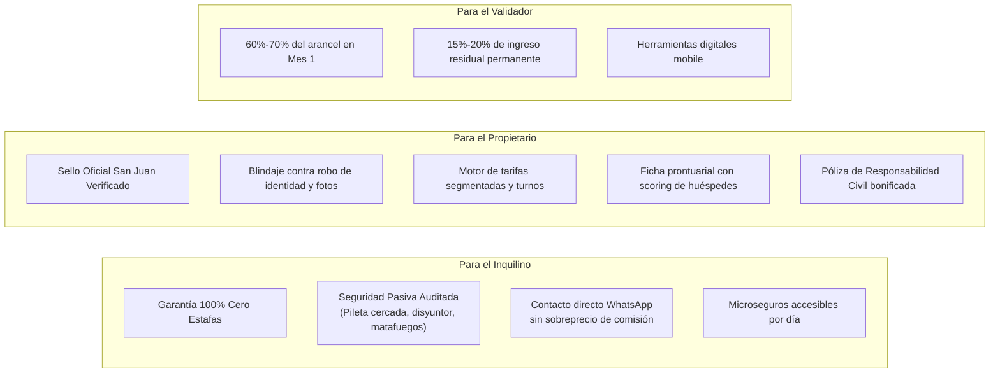
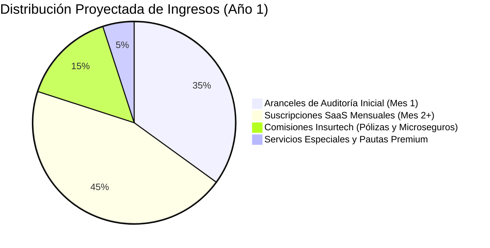

# Business Model Canvas (BMC)
## Turismo Seguro — San Juan Verificado

> **Basado en el Dossier Integral de Modelo de Negocio (`doc/pdf/modelo_de_negocio.html`), el PRD y la Arquitectura Contract-First del Sistema.**

El **Business Model Canvas (Lienzo de Modelo de Negocio)** estructura la lógica estratégica de generación, entrega y captura de valor de Turismo Seguro a través de los 9 bloques canónicos de Alexander Osterwalder.

---

## 1. Lienzo Visual Sintético (Los 9 Bloques)

```
┌─────────────────────────┬─────────────────────────┬─────────────────────────┬─────────────────────────┬─────────────────────────┐
│ 8. ASOCIACIONES CLAVE   │ 7. ACTIVIDADES CLAVE    │ 2. PROPUESTAS DE VALOR  │ 4. RELACIÓN CON CLIENTES│ 1. SEGMENTOS DE CLIENTES│
│                         │                         │                         │                         │                         │
│ • Validadores Comerciales│ • Auditoría pericial    │ • Cero estafas: 100%    │ • Confianza física      │ • Propietarios de       │
│   matriculados en calle.│   física in situ.       │   presencial in situ.   │   pericial garantizada. │   quintas recreativas y │
│ • Aseguradoras aliadas  │ • Emisión de Actas y    │ • Sello San Juan        │ • Acompañamiento        │   cabañas en San Juan.  │
│   (Triunfo Seguros).    │   Tokens QR diferidos.  │   Verificado oficial.   │   personalizado comercial│ • Residentes sanjuaninos│
│ • Ministerio de Turismo │ • Gobernanza antifraude │ • Blindaje contra       │   de calle.             │   (cumpleaños, eventos, │
│   y Cultura de San Juan.│   de CBU/DNI.           │   usurpaciones y clones.│ • Autogestión ágil SaaS  │   fines de semana).     │
│ • Municipios turísticos │ • Desarrollo y soporte  │ • Motor tarifario multi-│   en plataforma web.    │ • Turistas nacionales e │
│   (Rivadavia, Pocito,   │   del SaaS y catálogo.  │   modalidad y turnos.   │ • Transparencia de datos │   internacionales.      │
│   Zonda, Calingasta).   │ • Campañas de marketing │ • Ficha prontuarial con │   (sin comisiones       │ • Fuerza de venta y     │
│ • Cámaras inmobiliarias │   digital y de demanda. │   scoring de inquilinos.│   ocultas a huéspedes). │   validación en calle.  │
│   y de turismo local.   │                         │ • Cobertura de RC y     │                         │                         │
│                         ├─────────────────────────┤   microseguros en 2 clic│                         ├─────────────────────────┤
│                         │ 6. RECURSOS CLAVE       │                         │                         │ 3. CANALES              │
│                         │                         │                         │                         │                         │
│                         │ • Red de validadores    │                         │                         │ • Plataforma Web oficial│
│                         │   matriculados.         │                         │                         │   (PWA Responsive).     │
│                         │ • Plataforma web y API  │                         │                         │ • WhatsApp oficial      │
│                         │   OpenAPI 3.1.          │                         │                         │   auditado y directo.   │
│                         │ • Marca y Sello QR      │                         │                         │ • Fuerza de venta en    │
│                         │   San Juan Verificado.  │                         │                         │   terreno (prospección).│
│                         │ • Base de datos de actas│                         │                         │ • Redes sociales y SEO  │
│                         │   y scoring acumulado.  │                         │                         │   geolocalizado.        │
├─────────────────────────┴─────────────────────────┴─────────────────────────┴─────────────────────────┴─────────────────────────┤
│ 9. ESTRUCTURA DE COSTES                           │ 5. FUENTES DE INGRESOS                                                      │
│                                                   │                                                                             │
│ • Comisiones a validadores (60%-70% Mes 1, 15%-20% residual Mes 2+).│ • Tarifa inicial de alta por auditoría in situ (Mes 1).                     │
│ • Infraestructura tecnológica (hosting, servidores, dominios, SSL). │ • Suscripción mensual SaaS del anfitrión (Mes 2 en adelante).               │
│ • Pauta publicitaria digital (Meta Ads, Google Ads geolocalizado).   │ • Comisión de corretaje/intermediación por pólizas y microseguros.         │
│ • Honorarios legales, contables e impositivos provinciales.         │ • Aranceles por eventos especiales de gran aforo y pautas destacadas.      │
└───────────────────────────────────────────────────┴─────────────────────────────────────────────────────────────────────────────┘
```

---

## 2. Desglose Estratégico de los 9 Bloques

### 1. Segmentos de Clientes (Customer Segments)
Turismo Seguro opera un modelo **Multi-Lado (Multi-Sided Platform)** que conecta oferta, demanda y operadores de control:

1. **Anfitriones y Propietarios de Quintas / Cabañas (`client`):**
   * *Quintas recreativas diurnas:* Propietarios en zonas de esparcimiento (Médano de Oro, Rawson, Pocito, Santa Lucía) que alquilan por día para reuniones familiares, eventos o piscina.
   * *Cabañas y Posadas turísticas:* Alojamientos en valles cordilleranos (Zonda, Ullum, Calingasta, Iglesia, Valle Fértil) que operan bajo régimen de pernocte/noche.
   * *Complejos de Eventos:* Predios con quinchos de gran capacidad (40 a 100+ personas) con necesidad de cobertura de aforo ampliado.
2. **Inquilinos y Usuarios Interesados (`rent`):**
   * *Demanda Local Sanjuanina (Alta Frecuencia):* Familias y grupos de amigos que buscan pasar un día de pileta el fin de semana, celebrar cumpleaños o realizar encuentros corporativos sin intermediarios abusivos.
   * *Turismo Nacional e Internacional:* Viajeros que arriban por vacaciones, fines de semana largos, Fiesta Nacional del Sol o turismo aventura y exigen certidumbre total de que el predio existe y cumple estándares de seguridad.
3. **Validadores Comerciales Matriculados (`validator`):**
   * Técnicos, martilleros, estudiantes avanzados de turismo/higiene y profesionales independientes que buscan una fuente de ingresos combinando comisiones de captación en calle con ingresos residuales recurrentes.

---

### 2. Propuestas de Valor (Value Propositions)



* **Factor Diferencial Absoluto:** "Cero publicación sin inspección física presencial in situ". Ningún competidor tradicional (Airbnb, Booking, Facebook Marketplace) garantiza la existencia física ni la seguridad pasiva de la propiedad en el territorio de San Juan.

---

### 3. Canales de Distribución y Comunicación (Channels)

* **Canal Web Directo (Portal PWA / Responsive):** Experiencia ágil optimizada para smartphone, búsqueda georreferenciada por departamentos, filtros de capacidad, amenities y categorización transparente.
* **Canal WhatsApp Auditado:** Botón directo preformateado que conecta al interesado directamente con el número telefónico cotejado del titular, eliminando estafadores intermedios.
* **Fuerza de Venta en Terreno (Validadores de Prospección):** Visita personalizada puerta a puerta en Médano de Oro, Zonda, Pocito, etc., explicando los beneficios y formalizando la adhesión.
* **Canales Institucionales y Punto de Información Turística:** Difusión en la Fiesta Nacional del Sol, terminal de ómnibus, sitios del Ministerio de Turismo y municipios adheridos.
* **Marketing Digital Geolocalizado:** Campañas en Meta (Instagram/Facebook) y Google Search atacando términos de alta intención (*"alquiler quinta pileta san juan seguro"*, *"alquiler zonda sin estafas"*).

---

### 4. Relación con los Clientes (Customer Relationships)

* **Con el Propietario (Alianza B2B/B2Pro):**
  * Asesoramiento técnico y comercial en la visita inicial.
  * Autonomía y control pleno mediante el Panel del Propietario SaaS (gestión de calendario, tarifas de fin de semana, bloqueos por vacaciones).
  * Soporte preventivo ante huéspedes problemáticos a través de la Mesa de Supervisión.
* **Con el Inquilino (Confianza B2C y Cero Fricción):**
  * Transparencia total de datos (fotos auténticas de fachada y ambientes, número de acta pericial visible).
  * Ausencia de comisiones ocultas agregadas al valor del alquiler.
  * Protección ante reclamos mediante trazabilidad de pagos al CBU auditado del titular.
* **Con la Red de Validadores (Comunidad de Socios Comerciales):**
  * Liquidaciones puntuales, tablero transparente de comisiones ganadas y acompañamiento de la Mesa de Supervisión.

---

### 5. Fuentes de Ingresos (Revenue Streams)



1. **Arancel Inicial de Auditoría y Alta In Situ (Mes 1):**
   * Arancel único pagado por el propietario para costear la visita pericial, el test de seguridad, el acta técnica y el alta del código QR antifraude.
2. **Suscripción Mensual SaaS del Anfitrión (Mes 2 en adelante):**
   * Cuota recurrente para mantener el Sello Activo, indexación preferente en el motor de búsqueda, calendario interactivo y acceso a la ficha de inquilinos.
3. **Margen por Intermediación de Seguros (Insurtech):**
   * *Propietarios:* Porcentaje de comisión por convenio anual o póliza mensual de Responsabilidad Civil emitidas con Triunfo Seguros.
   * *Inquilinos:* Margen por emisión de microseguros diarios de accidentes personales y cobertura de eventos.
4. **Tarifas por Eventos Especiales y Destacados:**
   * Suplementos para predios de gran aforo y posicionamiento promocional estacional en portada.

---

### 6. Recursos Clave (Key Resources)

* **Recursos Humanos Especializados:** Red territorial de validadores matriculados, Supervisores de calidad pericial y equipo de desarrollo de software.
* **Plataforma Tecnológica Propietaria:**
  * Backend robusto en Laravel 13 con autenticación Sanctum y arquitectura Contract-First (OpenAPI 3.1).
  * Frontend reactivo en Vue 3 con Design System Stitch "San Juan Verificado".
  * Base de datos relacional de actas periciales, geolocalización milimétrica y reputación cruzada.
* **Activos Intelectuales y de Marca:**
  * Registro de marca "Turismo Seguro" y sello "San Juan Verificado".
  * Metodología de auditoría in situ y checklist de seguridad pasiva estandarizado.
  * Base de datos acumulada de calificaciones e historial de huéspedes.

---

### 7. Actividades Clave (Key Activities)

* **Auditoría Técnica y Operativa In Situ:** Inspección presencial obligatoria, verificación de disyuntores, cercos de pileta, matafuegos y georreferenciación.
* **Control y Prevención Antifraude (Torre de Supervisión):**
  * Asignación zonal de peritos y emisión de tokens de seguridad diferidos.
  * Cruce bancario fehaciente (CBU / Billetera Virtual vs DNI).
  * Evaluación y emisión del dictamen técnico formal.
* **Desarrollo y Mantenimiento Tecnológico:** Evolución continua del SaaS, seguridad de APIs, monitoreo de disponibilidad y experiencia de usuario.
* **Captación Comercial y Fidelización:** Campañas de incorporación de nuevos propietarios en zonas turísticas y retención de cartera activa.
* **Marketing de Demanda y Posicionamiento:** Generación constante de tráfico calificado de turistas y familias sanjuaninas hacia el catálogo verificado.

---

### 8. Asociaciones Clave (Key Partnerships)

* **Compañías Aseguradoras (Triunfo Seguros):**
  * Alianza estratégica para ofrecer pólizas de Responsabilidad Civil y microseguros diarios simplificados en 2 clics, apalancándose en la inspección física de Turismo Seguro para reducir su siniestralidad a cero.
* **Ministerio de Turismo, Cultura y Deporte de San Juan:**
  * Respaldo institucional, fomento de la formalización del parque de alojamiento temporario y promoción conjunta en eventos oficiales.
* **Municipios Turísticos y Delegaciones Departamentales:**
  * Alianzas con Rawson (Médano de Oro), Pocito, Rivadavia, Zonda, Ullum y Calingasta para cruce de normativas de habilitación y difusión local.
* **Validadores y Peritos Matriculados:**
  * Socios comerciales estratégicos en terreno que actúan como la cara visible y fuerza de expansión del negocio.
* **Cámaras Inmobiliarias y de Comercio:**
  * Cooperación para evitar la competencia desleal de intermediarios no autorizados y estafadores de redes sociales.

---

### 9. Estructura de Costes (Cost Structure)

* **Costes Variables (Directamente asociados al volumen):**
  * *Comisiones a Validadores:* 60%-70% del arancel de alta (Mes 1) y 15%-20% mensual de la cuota recurrente (Mes 2+).
  * *Pauta Publicitaria Digital:* Inversión en adquisición de tráfico en Google Ads y Meta Ads.
  * *Costos de emisión de pólizas:* Liquidación a la aseguradora por microseguros emitidos.
* **Costes Fijos (Operación y Mantenimiento de la Empresa):**
  * *Infraestructura Cloud:* Servidores, base de datos gestionada, balanceadores, certificados SSL y CDN.
  * *Equipo Nuclear:* Salarios del Supervisor de Calidad, desarrollador/mantenimiento tecnológico y administración contable.
  * *Gastos Legales, Notariales y Tributarios:* Impuestos provinciales (DGR San Juan), tasas municipales y personería jurídica.
