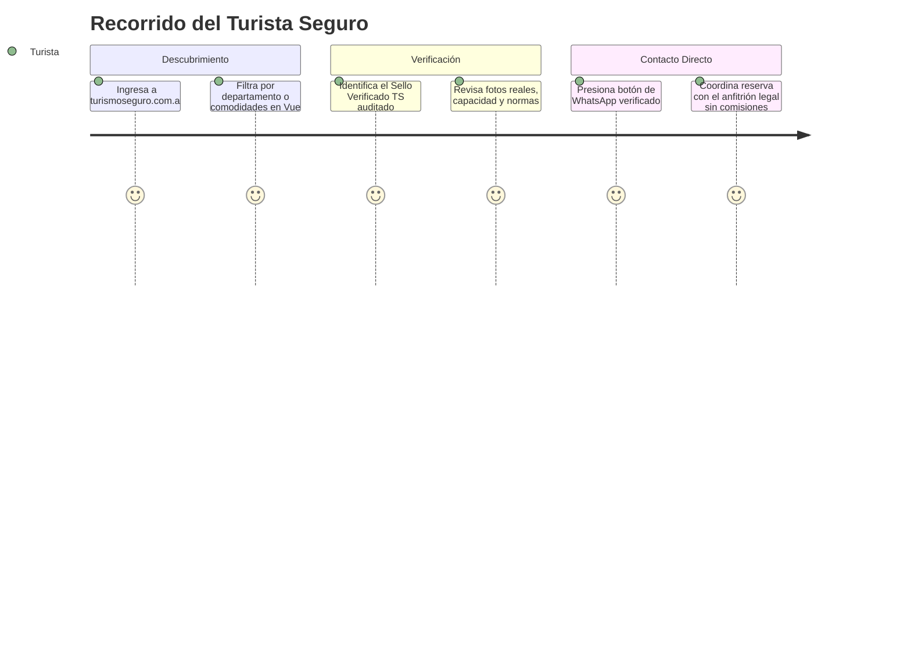
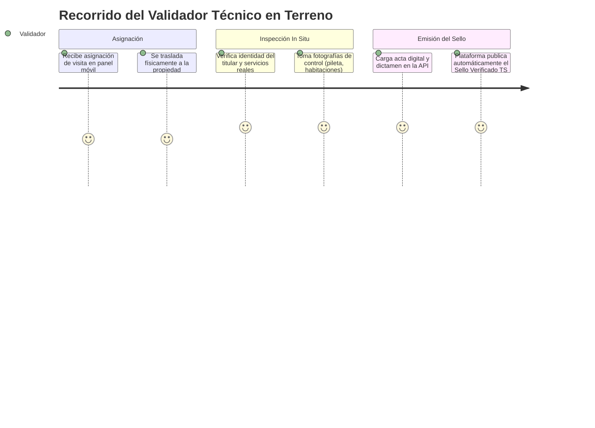

# Contexto del Proyecto: Turismo Seguro San Juan

## 1. Propósito y Modelo de Negocio Privado

**Turismo Seguro San Juan** es una iniciativa y plataforma digital **privada** nacida para dar solución a una problemática crítica que afecta al mercado turístico y a los visitantes de la provincia de San Juan: **las estafas en alquileres temporales y experiencias informales no verificadas**.

### El Problema en el Mercado:
- Cuentas y perfiles apócrifos en redes sociales (Facebook Marketplace, grupos abiertos de alquileres, anuncios clasificados libres) publican fotografías de cabañas o casas que no existen o de las cuales no son propietarios.
- Los turistas transfieren señas bancarias o pagos totales anticipados y, al arribar a San Juan, constatan el engaño sin posibilidad de respuesta.
- Los anfitriones y prestadores turísticos honestos pierden reservas, y la percepción de seguridad del destino se deteriora.

### La Solución de Certificación Privada:
Construir una plataforma de confianza y certificación privada independiente donde **cada alojamiento o experiencia turística cuenta con una auditoría física *in situ*** realizada por un cuerpo de validadores e inspectores técnicos de la empresa. El otorgamiento del **Sello "Verificado TS"** garantiza que el inmueble existe, que las instalaciones son reales y que los canales de contacto directo (WhatsApp y teléfono) pertenecen legítimamente al anfitrión verificado.

### Articulación Institucional (Convenios de Colaboración):
Aunque la titularidad, operación y dominios son de carácter **privado e independiente**, la plataforma prevé la formalización de **convenios marco de colaboración público-privada** con la Secretaría / Ministerio de Turismo de San Juan, municipios y cámaras de turismo locales para promover la transparencia, la formalización de la oferta y la promoción del destino seguro.

---

## 2. Diagnóstico del Estado Actual (Código Legacy)

El proyecto cuenta con un prototipo estático inicial ubicado en el directorio `legacy/`:

### Archivos Existentes:
1. `index.html`: Landing page principal con Hero, sección informativa de valor, alquileres destacados, departamentos de San Juan, experiencias turísticas y formulario de contacto.
2. `alquileres.html` + `alquileres.js` + `alquileres.css`: Catálogo de propiedades con filtros básicos.
3. `detalle-alquiler.html` + `detalle-alquiler.js` + `detalle-alquiler.css`: Ficha técnica de propiedad con galería, comodidades y botones de contacto directo a WhatsApp y llamada.
4. `experiencias-listado.html` + `experiencias.js` + `experiencias.css`: Listado de experiencias turísticas (astroturismo en El Leoncito, Ischigualasto, diques, etc.).
5. `detalle-experiencia.html` + `detalle-experiencia.js` + `detalle-experiencia.css`: Detalle de experiencia con recomendaciones y contacto del operador.
6. `img/`: Activos visuales estáticos organizados por departamentos, experiencias y propiedades.

### Limitaciones del Prototipo Legacy:
- **Datos "Hardcodeados":** Información incrustada en objetos JS locales (`alquileresDB`, `experienciasDB`) duplicados entre archivos, sin base de datos ni persistencia relacional.
- **Sin Panel Administrativo ni de Campo:** No existe interfaz para que los validadores carguen actas de inspección in situ ni para que la administración gestione solicitudes y métricas.
- **Duplicación de Código y Estilos:** Múltiples copias de cabeceras, pies de página y tarjetas sin componentización modular.

---

## 3. Actores y Flujos de Valor

---

## 4. Definición de Alcance del MVP

### Incluido en el MVP:
- **Portal Público Web / Móvil (`client/` en Vue 3):** Búsqueda y filtrado reactivo de propiedades y experiencias, fichas de detalle, navegación por departamentos y contacto directo verificado vía WhatsApp.
- **Sello "Verificado TS":** Identificador visual de auditoría in situ con información de fecha de inspección.
- **Portal de Anfitriones:** Solicitud de certificación y carga de datos del inmueble.
- **Panel Operativo para Validadores y Administradores:** Gestión de visitas técnicas, acta de inspección con carga de fotos de control y aprobación/rechazo del sello.
- **Backend API REST (`server/` en Laravel):** Gestión de persistencia, reglas de negocio, endpoints seguros y autenticación vía Sanctum.

### Fuera de Alcance del MVP (Fases Futuras):
- Pasarela de cobro o pagos en línea de reservas dentro del sistema.
- Aplicación nativa móvil publicada en App Store / Play Store (en MVP se opera vía Web Responsive / PWA).
- Sistema abierto de valoraciones o comentarios no auditados.

---

## 5. Decisiones Técnicas y de Infraestructura

1. **Arquitectura Desacoplada (`server/` y `client/`):**
   - Backend API en Laravel y Frontend SPA en Vue 3 con Vite y Tailwind CSS en directorios independientes.
   - Prepara el sistema para incorporar aplicaciones móviles nativas futuras (Capacitor/Ionic) consumiendo la misma API sin duplicar lógica.
2. **Dominios Privados y Seguridad:**
   - Dominio comercial de primer nivel (ej. `turismoseguro.com.ar` y subdominio API `api.turismoseguro.com.ar`).
   - Autenticación SPA segura mediante cookies `HttpOnly` y protección CSRF con Laravel Sanctum.
3. **Persistencia Ligera y Escalable:**
   - Base de datos en SQLite para máxima agilidad en el MVP y pruebas, abstraída completamente mediante Eloquent ORM para migrar a PostgreSQL o MySQL según el crecimiento del servicio.
