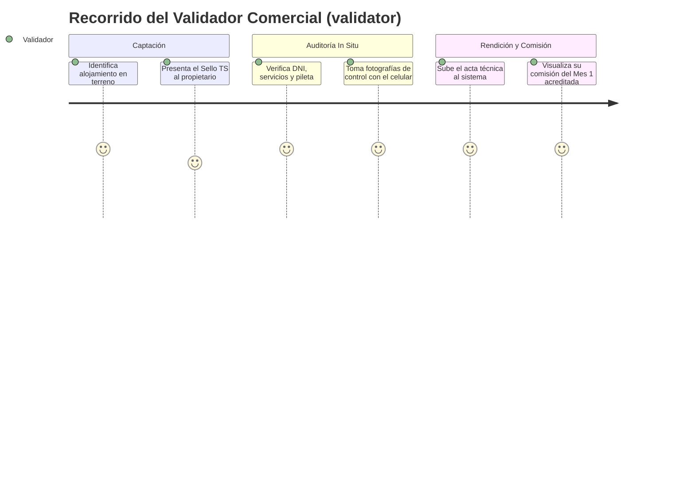
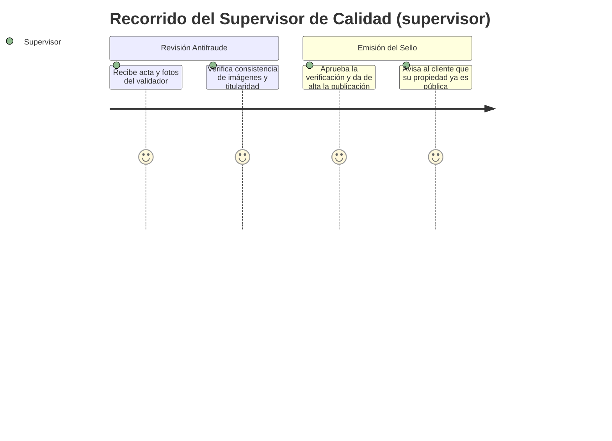
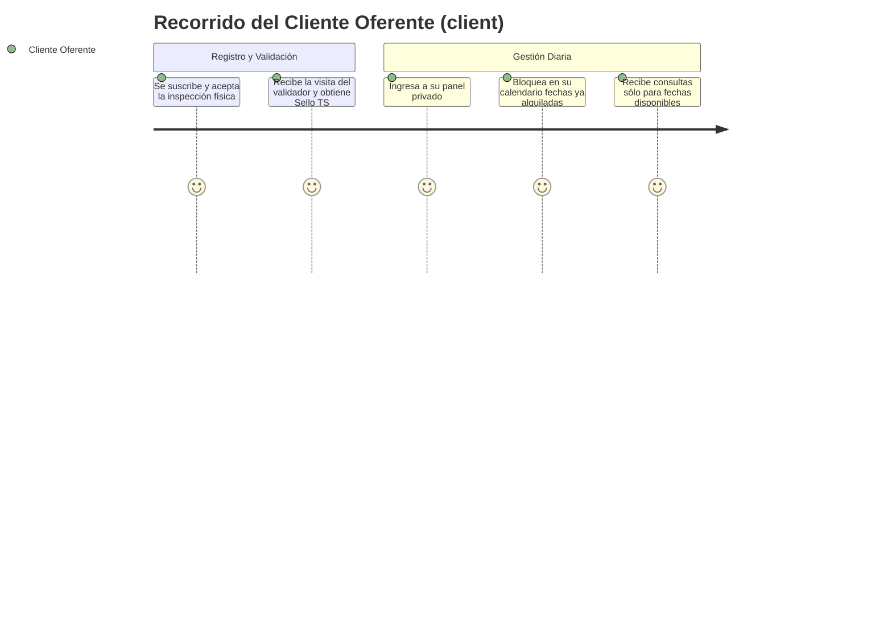
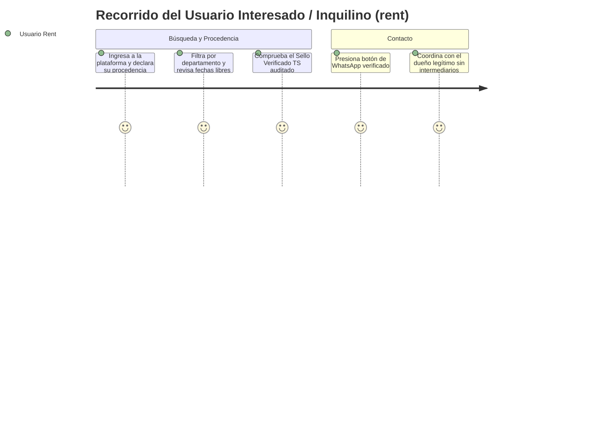

# Contexto del Proyecto: Turismo Seguro San Juan

## 1. Propósito y Modelo de Negocio Privado

**Turismo Seguro San Juan** es una empresa y plataforma digital **privada** concebida para transformar el mercado de alquileres temporales y experiencias en la provincia de San Juan, Argentina, erradicando las estafas virtuales mediante la **auditoría física *in situ*** y el otorgamiento del sello de calidad **"Verificado TS"**.

### La Oportunidad y el Negocio de Confianza:
- **La problemática:** Miles de personas son defraudadas anualmente mediante publicaciones falsas en redes sociales. Al mismo tiempo, los propietarios y anfitriones honestos sufren desconfianza y pierden clientes.
- **La propuesta económica:** La plataforma ofrece a los **clientes oferentes (`client`)** un **Sello Oficial de Confianza**, difusión preferencial y herramientas de gestión a cambio de una tarifa de verificación inicial y una suscripción mensual accesible.
- **Regla estricta:** Ningún cliente puede publicar en la plataforma sin haber sido auditado y aprobado físicamente. El sello es un certificado real de existencia y titularidad.

### Fuerza de Ventas y Esquema de Comisiones para Validadores:
Para romper la inercia del mercado y captar rápidamente a los mejores alojamientos de San Juan (en Calingasta, Barreal, Zonda, Valle Fértil, Ullum, Iglesia, etc.), los validadores actúan como **auditores de campo y promotores comerciales**:
1. **Comisión de Captación (Mes 1):** El validador recibe entre un **60% y 70%** del primer pago del cliente oferente al cerrar la incorporación y completar la inspección.
2. **Comisión Recurrente (Meses posteriores):** El validador mantiene un porcentaje residual mensual (entre **15% y 20%**) por cada cliente que continúe activo en su cartera.
3. **Margen de la Plataforma:** El remanente cubre el soporte operativo, marketing de atracción y el beneficio neto de la empresa.

---

## 2. Los 5 Actores y sus Flujos de Valor (User Journeys)

### Particularidad del Rol `rent` (Procedencia):
El usuario del rol `rent` no siempre es un turista de otra provincia o país; con frecuencia es un **residente local de San Juan** que busca alquilar una casa de campo, quinta o cabaña para un fin de semana o evento familiar. Por ello, la plataforma contempla:
- **Consulta de Procedencia Geográfica:** Registro de origen del usuario (si es habitante local de San Juan —y de qué departamento— o si proviene de otra provincia o del exterior).
- **Valor para el Negocio:** Permite segmentar analíticas para el Super Admin y para entes de turismo (convenios): qué porcentaje de la demanda es turismo receptivo externo vs turismo interno/escapadas locales.

---

## 3. Diagnóstico del Estado Actual (Código Legacy)

El proyecto cuenta con un prototipo estático inicial en `legacy/`:
- **Puntos valiosos a preservar:** Banco inicial de fotografías de departamentos sanjuaninos (`img/departamentos/`), ejemplos de cabañas y experiencias turísticas representativas.
- **Limitaciones a superar:**
  - Código duplicado en 5 archivos HTML y scripts dispersos.
  - Datos hardcodeados en variables JS locales sin base de datos.
  - Ausencia de roles, autenticación, módulo de actas de inspección, liquidación de comisiones y calendario de disponibilidad.

---

## 4. Decisiones Técnicas y de Arquitectura

1. **Arquitectura Desacoplada (`server/` y `client/`):**
   - Backend en **Laravel API** (rutas `routes/api.php`, Sanctum SPA, Form Requests, Resources).
   - Frontend en **Vue 3** (Composition API con `<script setup>`, Pinia, Tailwind CSS y Vite).
2. **Enfoque de Composables en Vue 3:**
   - La lógica de negocio del cliente se modulariza estrictamente en Composables reutilizables (`useAuth`, `useProperties`, `useAvailability`, `useInspection`, `useCommissions`).
3. **Persistencia y Base de Datos:**
   - Base de datos en SQLite para máxima agilidad en desarrollo y MVP, abstraída con Eloquent ORM para migrar a PostgreSQL o MySQL en producción.
4. **Seguridad y Dominios Privados:**
   - Frontend en `turismoseguro.com.ar` y API en `api.turismoseguro.com.ar`.
   - Autenticación segura mediante cookies `HttpOnly` y protección CSRF con Laravel Sanctum en el MVP, con proyección inmediata a Google OAuth (Socialite).
