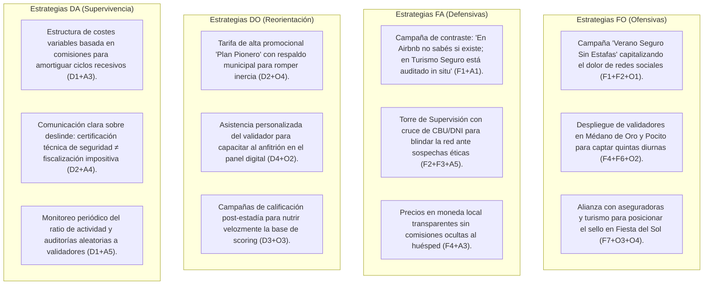

# Matriz FODA y Estrategias CAME
## Turismo Seguro — San Juan Verificado

> **Análisis Estratégico basado en el PRD, el Business Model Canvas y el Dossier de Modelo de Negocio (`doc/pdf/modelo_de_negocio.html`).**

El análisis **FODA (Fortalezas, Oportunidades, Debilidades y Amenazas / SWOT)** evalúa la posición competitiva interna y el entorno externo de **Turismo Seguro**. Se complementa con la **Matriz CAME** (Corregir debilidades, Afrontar amenazas, Mantener fortalezas y Explotar oportunidades) formulando las estrategias de acción (FO, FA, DO, DA).

---

## 1. Matriz FODA Sintética

```
┌─────────────────────────────────────────────────────────┬─────────────────────────────────────────────────────────┐
│ FACTORES INTERNOS                                       │ FACTORES EXTERNOS                                       │
├─────────────────────────────────────────────────────────┼─────────────────────────────────────────────────────────┤
│ FORTALEZAS (F)                                          │ OPORTUNIDADES (O)                                       │
│                                                         │                                                         │
│ F1. Auditoría física presencial obligatoria in situ.    │ O1. Epidemia de estafas virtuales en Facebook e IG.    │
│ F2. Token antifraude diferido y congelamiento preventivo│ O2. Boom de turismo de cercanía y quintas diurnas       │
│     durante el trámite de validación.                   │     en familias y residentes de San Juan.               │
│ F3. Gobernanza bancaria: CBU/CVU único cruzado con DNI. │ O3. Grandes eventos provinciales (Fiesta Nacional del   │
│ F4. Motor tarifario multi-modalidad nativo (turnos      │     Sol, TC El Villicum, Vuelta a San Juan, vendimias). │
│     diurnos, eventos, fines de semana, pernocte).       │ O4. Alianza estratégica con el Ministerio de Turismo    │
│ F5. Ficha prontuarial con scoring canónico de inquilinos│     y municipios para formalizar el parque de alquileres.│
│     (5 estados) y algoritmo anti-bias de anfitriones.   │ O5. Inexistencia de competidores con inspectores        │
│ F6. Esquema de comisiones escalonadas a validadores     │     físicos en territorio sanjuanino.                   │
│     (60%-70% Mes 1 / 15%-20% residual) en calle.        │ O6. Expansión escalable a provincias vecinas de Cuyo    │
│ F7. Alianza Insurtech (Triunfo Seguros): pólizas y      │     (Mendoza, San Luis, La Rioja).                      │
│     microseguros en 2 clics.                            │                                                         │
│ F8. Arquitectura Contract-First moderna y escalable     │                                                         │
│     (Laravel 13 + Vue 3 + Tailwind Stitch).             │                                                         │
├─────────────────────────────────────────────────────────┼─────────────────────────────────────────────────────────┤
│ DEBILIDADES (D)                                         │ AMENAZAS (A)                                            │
│                                                         │                                                         │
│ D1. Dependencia de la logística y movilidad de la       │ A1. Plataformas multinacionales (Airbnb, Booking) con   │
│     fuerza humana de validadores en calle.              │     enormes presupuestos globales de marketing.        │
│ D2. Resistencia inicial al pago en propietarios         │ A2. Arraigo del canal informal gratuito en redes        │
│     acostumbrados a publicar gratis en redes sociales.  │     sociales y grupos no regulados.                     │
│ D3. Base de datos de scoring de inquilinos en fase de   │ A3. Volatilidad macroeconómica que afecte el poder      │
│     acumulación inicial de volumen histórico.           │     adquisitivo y el gasto recreativo familiar.         │
│ D4. Curva de adopción tecnológica en anfitriones rurales│ A4. Fobia de propietarios informales a controles        │
│     o de edad avanzada (Calingasta, Iglesia, Zonda).    │     fiscales provinciales o nacionales (DGR/AFIP).      │
│ D5. Alcance de marca en fase inicial de penetración     │ A5. Riesgo de colusión o negligencia entre anfitrión    │
│     fuera de los polos urbanos principales.             │     y validador (mitigado por la Torre de Supervisión). │
└─────────────────────────────────────────────────────────┴─────────────────────────────────────────────────────────┘
```

---

## 2. Análisis Detallado de Factores

### 2.1 Factores Internos (Controlables)

#### Fortalezas (F)
* **F1 — Certificación Física Pericial In Situ:** A diferencia de cualquier plataforma virtual, ningún inmueble se publica sin la presencia física de un perito que constate la existencia real de la casa, su fachada y sus comodidades.
* **F2 — Blindaje Antifraude Integral:** El proceso incluye un token de seguridad diferido de 6 dígitos emitido por el supervisor y el bloqueo operativo total (calendario y tarifas congeladas) durante la inspección.
* **F3 — Trazabilidad Bancaria Inquebrantable:** Validación de que la cuenta receptora de señas (CBU o Billetera Virtual) coincida en un 100% con el titular dominial acreditado con DNI, erradicando cuentas intermediarias o delictivas.
* **F4 — Motor Tarifario Adaptado a San Juan:** Resuelve el dolor de las quintas recreativas diurnas permitiendo precios diferenciados para Lun-Jue, Vie-Dom, Feriados, Eventos con gran aforo y Turnos (Mañana, Tarde, Día Completo).
* **F5 — Sistema de Calificación y Ficha Prontuarial de Huéspedes:** Escala canónica de 5 niveles (`up`, `follow_up`, `down`, `rejected`, `none`) con veto automático y algoritmo *anti-bias* para proteger a los anfitriones de inquilinos dañinos.
* **F6 — Modelo de Incentivos Comerciales Agresivo:** Los validadores ganan entre el 60% y el 70% del arancel de alta y conservan un residual de 15% a 20% mensual, garantizando una fuerza de venta motivada y proactiva.
* **F7 — Integración Insurtech (Triunfo Seguros):** Emisión instantánea de pólizas de Responsabilidad Civil para dueños y microseguros diarios para inquilinos, apalancándose en la inspección previa.
* **F8 — Infraestructura Contract-First de Alta Confiabilidad:** Especificación OpenAPI 3.1, Laravel 13 con Form Requests validados y frontend reactivo en Vue 3 con el Design System "San Juan Verificado".

#### Debilidades (D)
* **D1 — Cuello de Botella Operativo en Validación Física:** El ritmo de incorporación de propiedades está acotado a la disponibilidad de inspectores y movilidad en zonas distantes.
* **D2 — Fricción de Entrada ("Romper la Inercia"):** Reticencia de algunos propietarios a pagar un arancel de auditoría y membresía mensual frente a la gratuidad de Facebook Marketplace.
* **D3 — Historial de Reputación en Desarrollo:** El valor predictivo de la ficha de inquilinos requiere de varias temporadas de reservas para alcanzar su masa crítica.
* **D4 — Brecha Digital en Propietarios Rurales:** Anfitriones tradicionales que requieren asistencia humana para gestionar el calendario y los precios en la aplicación web.
* **D5 — Posicionamiento de Marca Inicial:** Turismo Seguro debe construir rápidamente notoriedad frente a la inercia del público de buscar en plataformas ya instaladas.

---

### 2.2 Factores Externos (Entorno)

#### Oportunidades (O)
* **O1 — Alarma Social por Ciberestafas en Alquileres:** Noticias constantes de familias estafadas con señas de alquileres inexistentes en San Juan generan una necesidad urgente de un "Sello de Autenticidad".
* **O2 — Explosión de la Demanda Recreativa de Cercanía:** El residente sanjuanino busca intensamente quintas con pileta para pasar el día en Médano de Oro, Pocito, Rivadavia y Santa Lucía todos los fines de semana.
* **O3 — Calendario de Mega-Eventos en San Juan:** La Fiesta Nacional del Sol, eventos deportivos en el Circuito San Juan Villicum, la Vuelta Ciclística y el turismo de bodegas saturan la plaza hotelera tradicional.
* **O4 — Apoyo Institucional y Regulatorio:** El Ministerio de Turismo y los municipios buscan ordenar el sector informal y respaldan iniciativas privadas que certifiquen calidad y seguridad pasiva.
* **O5 — Vacío de Competencia Presencial:** Ni Airbnb ni Booking tienen oficinas, peritos ni capacidad logística de acudir a inspeccionar una quinta en Médano de Oro.
* **O6 — Escalabilidad Regional:** El problema de las estafas en alquileres temporales es idéntico en Mendoza, San Luis y Córdoba, permitiendo replicar el modelo una vez consolidado San Juan.

#### Amenazas (A)
* **A1 — Presencia de Gigantes Internacionales:** Aunque vulnerables a estafas, Airbnb y Booking poseen un posicionamiento mental masivo entre turistas internacionales.
* **A2 — Persistencia de la Informalidad:** El hábito arraigado de concertar alquileres en grupos informales de WhatsApp o Facebook sin verificar.
* **A3 — Inestabilidad Económica y Caída del Ingreso:** Disminución del presupuesto disponible de las familias para salidas y recreación en períodos inflacionarios o recesivos.
* **A4 — Miedo a la Fiscalización Impositiva:** Confusión de los propietarios temiendo que la certificación técnica implique una fiscalización punitiva de rentas.
* **A5 — Riesgo de Desviación Ética en Terreno:** Posibles acuerdos fraudulentos entre dueños y validadores en calle (mitigado por la supervisión cruzada).

---

## 3. Matriz Estratégica Cruzada (CAME / FO, FA, DO, DA)



### 3.1 Estrategias Ofensivas (FO — Explotar Fortalezas para capturar Oportunidades)
1. **FO1 — Campaña "Verano Seguro en San Juan":** Aprovechar el clamor social contra las estafas en Facebook Marketplace (O1) comunicando masivamente la garantía física in situ (F1) y el código QR oficial de autenticidad (F2).
2. **FO2 — Foco en Quintas Recreativas Diurnas:** Desplegar la fuerza comercial de validadores en calle (F6) en las zonas de mayor concentración (Médano de Oro, Rawson, Pocito, Zonda) ofreciendo el motor de turnos diurnos (F4) justo antes de la temporada alta de piscina (O2).
3. **FO3 — Co-Branding con Triunfo Seguros y Entes Públicos:** Impulsar la Categoría 2 ("Oferta con Seguro Incluido") en eventos como la Fiesta Nacional del Sol (O3, O4), posicionando el sello como requisito de excelencia respaldado por el sector asegurador (F7).

### 3.2 Estrategias Defensivas (FA — Usar Fortalezas para neutralizar Amenazas)
1. **FA1 — Diferenciación Radical frente a Plataformas Globales:** Mientras Airbnb y Booking operan a miles de kilómetros sin validar si una quinta realmente tiene el cerco de pileta o si el anfitrión es real (A1), Turismo Seguro ofrece peritaje físico presencial, atención en WhatsApp y CBU auditado del titular (F1, F3).
2. **FA2 — Blindaje Antifraude de Doble Candado:** Neutralizar el riesgo de colusión interna (A5) mediante la Mesa de Supervisión independiente: el supervisor aprueba el dictamen tras validar fotos georreferenciadas y contrastar el CBU/CVU bancario con el DNI del anfitrión (F2, F3).
3. **FA3 — Precios Directos sin Sobreprecio en Dólares:** Frente a la pérdida de poder adquisitivo (A3), el catálogo no cobra comisiones ocultas del 15%-20% al huésped, conectándolo directamente con el anfitrión sin intermediarios financieros en divisa extranjera (F4).

### 3.3 Estrategias de Reorientación (DO — Corregir Debilidades aprovechando Oportunidades)
1. **DO1 — Arancel Promocional Bonificado para "Pioneros":** Vencer la resistencia inicial al pago (D2) mediante una tarifa de lanzamiento accesible ("Plan Pionero"), apalancada en los acuerdos de difusión con los municipios y el Ministerio de Turismo (O4).
2. **DO2 — Onboarding Presencial del Validador:** Superar la brecha tecnológica de anfitriones mayores o rurales (D4) capacitando a los validadores para que configuren el perfil, el calendario y las tarifas del predio directamente en la visita presencial (O2, O5).
3. **DO3 — Gamificación y Nutrición Acelerada del Scoring:** Estimular a propietarios e inquilinos a calificar sus estadías tras los mega-eventos provinciales (O3) para superar rápidamente la fase inicial de acumulación de datos de reputación (D3).

### 3.4 Estrategias de Supervivencia (DA — Mitigar Debilidades y evitar Amenazas)
1. **DA1 — Costes Fijos Ultralivianos y Compensación por Éxito:** Mantener la plataforma en una arquitectura cloud eficiente y remunerar a la fuerza de validadores mayoritariamente a comisión por alta y cartera activa (60-70% / 15-20%), reduciendo el riesgo ante retracciones económicas (D1, A3).
2. **DA2 — Deslinde Pedagógico Fiscal:** Diseñar folletería y mensajes claros que demuestren que Turismo Seguro es una certificación de **seguridad física y prevención de fraudes**, despejando el temor de los propietarios a inspecciones impositivas punitivas (D2, A4).
3. **DA3 — Protocolos Estrictos de Calidad y Revalidación Anual:** Establecer auditorías aleatorias del supervisor a propiedades ya aprobadas para mantener la disciplina técnica de los validadores y preservar el valor del Sello Verificado en el tiempo (D1, A5).

---

## 4. Hoja de Ruta Táctica e Indicadores de Seguimiento

| Fase Estratégica | Objetivo Principal | KPIs de Control |
| :--- | :--- | :--- |
| **Fase 1: Despliegue Zonal (Meses 1 - 3)** | Captar los primeros 60 predios en Médano de Oro, Pocito y Zonda. | • 10 validadores activos con cartera.<br>• 60 actas periciales aprobadas.<br>• 0 incidentes de estafa. |
| **Fase 2: Temporada Alta & Seguros (Meses 4 - 6)** | Maximizar la contratación de pólizas de RC y microseguros diarios. | • > 65% de predios en Categoría 2 (Con Seguro).<br>• > 85% de retención de membresía mensual. |
| **Fase 3: Consolidación & Scoring (Meses 7 - 12)** | Madurar la base de scoring de inquilinos y convenios municipales plenos. | • 150+ predios verificados.<br>• > 1.000 reservas calificadas en base de datos.<br>• Preparación de réplica en Mendoza / San Luis. |
